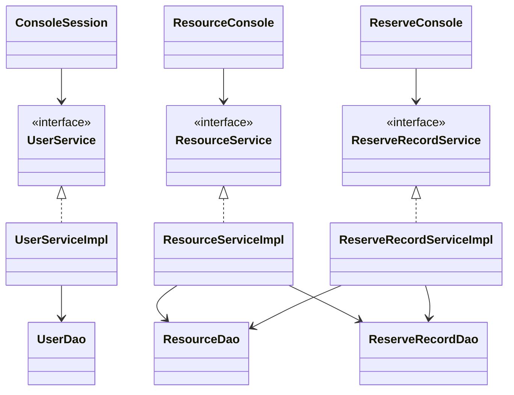

# V3.3 Service 抽象补充实验报告

日期：2026-11-18。本文记录本轮实际修改与验证，不替代此前 V3.3 单例与 DAO 工厂实验报告。

## 版本与目标

- 基线提交：`78f01379778482723e858284b93abb5c980a501f`。
- 本次源码提交：`21fe14ca8f22416f8a8bf7bc3516f9c45f181c3d`，提交说明为“V3.3: 补充Service接口抽象并保留单例实现”。
- 用户确认的目标：DAO 和 Service 均通过接口表达层间契约。DAO 已有接口，因此本轮补充 Service 接口，保留 V3.3 的饿汉式单例与简单 DAO 工厂。
- 固定工作目录：`C:\Users\22614\Desktop\大三上\软件构造\校园资源预约系统`。

实施顺序：冻结原源码并编译、验证原 Service 尚非接口；拆分接口与实现；比较业务方法签名和方法实现；运行新旧版本回归；审查差异后提交源码，并在本报告中记录其真实提交号。

## 设计与实现

| 接口文件 | 实现文件 | 公开业务方法数 |
| --- | --- | --- |
| `src/service/UserService.java` | `src/service/impl/UserServiceImpl.java` | 3 |
| `src/service/ResourceService.java` | `src/service/impl/ResourceServiceImpl.java` | 8 |
| `src/service/ReserveRecordService.java` | `src/service/impl/ReserveRecordServiceImpl.java` | 10 |

三个原 Service 文件改为接口。原业务逻辑移入 `service.impl`，实现类使用 `implements`，对应业务方法添加 `@Override`。接口保留原方法的参数、泛型返回类型和受检异常声明，也保留 UI 使用的权限检查、资源修改前置检查、预约时间解析入口。私有校验、查询、保存及恢复方法继续留在实现类。

`INSTANCE`、私有构造器、静态 `getInstance()` 放在实现类，保留饿汉式创建。实现类仍通过 `DaoFactory` 获取 DAO 接口，业务方法不直接依赖文件 DAO。

`ConsoleApplication` 是统一装配入口，改为通过 `UserServiceImpl.getInstance()` 等获取实现。`ConsoleSession`、`ResourceConsole`、`ReserveConsole` 原有字段及构造参数继续使用 `service.*` 类型，现在依赖接口。启动顺序仍为用户 DAO、资源 DAO、预约 DAO、Service、控制台会话。

以下图表示本次接口和实现的依赖关系，作为 V3.3 补充模型；原 V3.1 UML 保留为历史记录。



源码范围为 4 个修改文件、3 个新增实现文件。DAO、实体、异常、工具类、菜单和文件格式保持原样，未添加 ServiceFactory、通用父类、框架或后续任务的 MVC 功能。

## 实际环境与验证方式

系统环境为 Windows。使用以下实际 JDK，而非较新 JDK 的兼容编译目标：

```text
C:\Users\22614\AppData\Local\Programs\Temurin8\jdk8u504-b01\bin\javac.exe
C:\Users\22614\AppData\Local\Programs\Temurin8\jdk8u504-b01\bin\java.exe

javac 1.8.0_504
openjdk version "1.8.0_504"
OpenJDK Runtime Environment (Temurin)(build 1.8.0_504-b01)
OpenJDK 64-Bit Server VM (Temurin)(build 25.504-b01, mixed mode)
```

验证脚本使用 Python 3.14.3 调用上述编译器和运行时。先将原 `src` 冻结到项目内 `.service-abstraction-check-20261118/baseline-src`；各版递归收集全部 Java 文件，以 `javac -encoding UTF-8 -d` 编译。业务驱动分别链接两版，只有获取单例时选择旧 Service 类或新 Impl 类，业务调用保持 `service.*` 类型。

运行参数为 `java -Dfile.encoding=UTF-8 -cp <该版隔离类目录>`，入口为 `ServiceBehaviorCheck` 或 `ui.console.SystemMain`。所有会读写数据的进程均在验证目录内独立场景运行，没有从项目根目录启动业务程序。

实际执行的验证入口：

```text
rtk proxy python .service-abstraction-check-20261118/verify_structure.py
rtk proxy python -X utf8 .service-abstraction-check-20261118/run-service-regression.py
```

这些为本轮临时验证脚本，关键输入和实际结果归档于本报告，临时脚本、class 和测试数据不纳入版本。

## 结构验证结果

修改前 32 个源文件用 JDK 8 编译成功。接口契约检查针对三个 Service 调用 `Class.isInterface()`，实际结果为：

```text
UserService interface: FAIL
ResourceService interface: FAIL
ReserveRecordService interface: FAIL
Exception in thread "main" java.lang.AssertionError: 3 service contracts are concrete classes
```

该进程退出 1，失败原因是原 Service 为具体类。修改后 35 个源文件编译成功，同一契约检查退出 0：

```text
UserService interface: PASS
ResourceService interface: PASS
ReserveRecordService interface: PASS
```

反射提取两版的公开非静态方法，比较方法名、泛型参数、泛型返回类型和异常声明，21 项签名完全一致。对三个实现文件仅还原包名、类名、接口导入、`implements` 和 `@Override` 后，内容与原 Service 文件逐字一致，业务体及私有辅助方法未变。

独立只读代码审查未发现阻断问题。修改前记录的 71 个非目标原有文件的 SHA-256 保持一致；用户原有暂存报告和配置、旧报告、数据文件均保留。

## 运行回归结果

基线和重构版本各通过 91 项服务检查，各运行 8 个应用进程场景，共 16 个应用进程。所有应用进程退出码为 0，标准错误为空。

| 场景 | 实际检查内容 | 结果 |
| --- | --- | --- |
| 服务驱动 | 全部 21 个业务方法；单例身份及私有构造；登录注册、权限、资源增改删查、预约提交审核取消 | 两版各 91 项检查通过 |
| 服务数据重启 | 新 JVM 读取审核、取消和驳回数据，读取转义备注，检查查询不改变文件 | 两版一致 |
| 完整控制台流程 | 固定菜单输入、错误账号密码、短密码、重复注册、越权、时间格式、资源和预约操作 | 两版一致 |
| 控制台数据重启 | 再次登录查询已持久化的资源和预约 | 两版一致 |
| 用户文件损坏 | `user.txt` 写入 `broken|data` 后启动 | 对应加载失败提示一致 |
| 资源文件损坏 | `resource.txt` 写入 `broken|data` 后启动 | 对应加载失败提示一致 |
| 预约文件损坏 | `reserve.txt` 写入 `broken|data` 后启动 | 对应加载失败提示一致 |
| 空目录启动 | 输入 `0`，检查三个空数据文件的生成和退出 | 两版一致 |

比较范围为各场景完整标准输出，以及 `user.txt`、`resource.txt`、`reserve.txt` 的存在性和内容。随机 UUID 和实际运行时间窗口内生成的时间分别建立一一映射；同一值在输出、重启输出和文件中复用同一标记。预置 2020 年时间、固定 2099 年预约时间不变；没有删除消息、记录或字段，也没有排序输出来掩盖差异。两版分别包含 7 个动态 UUID、10 个动态时间值，规范化后的全部场景结果相同。

测试中的用户名、密码、资源和日期均为隔离目录内的合成输入，不是根目录现有数据。

## 测试输入与实际输出摘录

固定服务输入包括 `login("admin", "admin123")`，学生身份调用 `addResource(student, "x", "x", "x", "x")`，以及 `parseReserveTime("tomorrow")`。

状态联动输入：为 `seed-a` 提交 2099-01-01 10:00—11:00 和 11:00—12:00 两条预约，管理员依次通过，学生依次取消。检查取消第一条时仍为 OCCUPIED，取消最后一条后变为 AVAILABLE，取消保留原审核时间；取消待审核记录不生成审核时间。

控制台输入摘录如下，每个箭头分隔一行输入：

- 注册：`2 → cli_student → secret123`。
- 登录后尝试管理员资源操作：`1 → cli_student → secret123 → 2`。
- 提交并查询：`10 → seed-a → 2099-01-01 10:00 → 2099-01-01 11:00 → console|remark → 11`。
- 坏文件：分别将一个数据文件设为 `broken|data`，启动时输入 `0`。

实际输出摘录（省略重复菜单，其余保持原文）：

```text
CASE login admin | Result{success=true, msg='登录成功，欢迎使用校园资源预约系统！', data=User{username='admin', password='admin123', role='admin', registerTime=2020-01-01T00:00}}
CASE student add denied | PermissionDeniedException | 权限不足，仅管理员可以管理校园资源。
CASE parse invalid time | BusinessException | 时间格式错误，请使用 yyyy-MM-dd HH:mm。
CHECK cancel preserves audit | true
CHECK other approval retains occupied | true
CHECK last cancellation releases resource | true
CHECK pending cancellation has no audit | true
TOTAL_CHECKS=91
用户数据加载失败，请检查 user.txt。
资源数据加载失败，请检查 resource.txt。
预约数据加载失败，请检查 reserve.txt。
```

## 问题、处理与验证边界

第一轮测试脚本误将原提示预期写为“资源添加成功”，实际既有提示为“资源新增成功”。核对源码和真实输出后只修正测试预期，随后完整运行基线与重构版本均通过，没有为适配测试修改生产逻辑。

源码抽象检查和回归已覆盖本次改动目标，但未穷举全部非法参数组合，未重新注入磁盘写入失败或并发操作。原保存恢复逻辑逐字保留，本轮结果不表示已验证跨文件原子事务或并发安全。

本次仅创建本地版本保存点，不推送远程。原有 V2.0 暂存报告及其他用户未提交内容不纳入本次提交。
