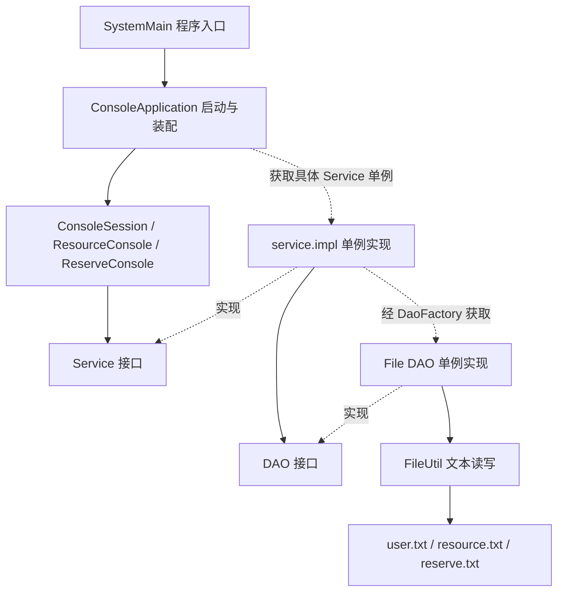

# 校园资源预约系统：课程答辩问答与知识讲解

本资料面向“软件构造”“系统分析与设计”课程复习与答辩，以源码提交 `21fe14ca8f22416f8a8bf7bc3516f9c45f181c3d` 为依据。该版本已将三个 Service 拆为接口与实现，源码共 35 个 Java 文件；整理开始时 HEAD 为 `327ad26`，其新增内容是实验报告。本文中的“当前实现”描述可在源码中核对的事实，“可以改进”描述尚未实施的设计建议。

全套共 245 道问答，其中 197 道逐一对应 35 个 Java 文件，另有 16 道核心知识、15 道综合追问和 17 道工程附录问题。文末提供每个源码文件的题号与章节索引。

这份资料没有修改业务代码，也没有把本轮阅读源码说成重新运行过测试。上次重构的真实编译和运行结果见 [V3.3 Service 抽象补充实验报告](../../reports/V3.3-Service抽象补充实验报告.md)。题目是根据项目和课程常见考点编写的模拟问题，不是教师公布的试题。

## 阅读导航

| 文档 | 内容 | Java 文件覆盖 |
| --- | --- | --- |
| [01 DAO 与实体](01-DAO与实体逐文件问答.md) | 接口、文件实现、工厂、单例、实体封装、枚举和关联 | 11 |
| [02 Service](02-Service逐文件问答.md) | 3 个业务接口、3 个单例实现，逐项解释业务方法和状态逻辑 | 6 |
| [03 UI 与异常](03-UI与异常逐文件问答.md) | 启动、交互、输出、分派、异常继承与处理 | 16 |
| [04 工具类](04-工具类逐文件问答.md) | 文件编码、转义解析、兼容加载、泛型结果和重载 | 2 |
| [05 综合追问与练习](05-综合追问与练习.md) | 跨文件调用、需求建模、测试设计、重构和改进顺序 | 跨文件综合 |
| [06 工程文件与历史版本](06-工程文件与历史版本.md) | IDE 配置、Git、数据文件、计划、报告与 UML 的答辩价值 | 非 Java 文件附录 |

每个 Java 文件都有独立章节。先读其职责，再遮住答案尝试作答，最后核对代码。答辩时可按“概念定义 → 项目位置 → 执行逻辑 → 选择理由 → 适用边界”的顺序回答，避免只复述类名。

## 一张图理解当前结构

实线和虚线在图中区分调用依赖与实现/装配关系。业务运行时最终执行具体对象的方法；接口决定调用者能够使用哪些能力。实体、异常和 `Result<T>` 是多个层共同使用的数据或类型，并不是顺次执行的三个独立业务层。

## 课程核心问题

### K01. 软件构造和系统分析与设计分别关注什么？这个项目怎样同时体现它们？

系统分析首先回答“谁在什么条件下需要系统完成什么”：学生提交、查询和取消自己的预约，管理员管理资源、审核和查询预约；还要明确角色边界、时间冲突、审核状态和数据保存要求。设计再回答“哪些对象合作完成这些用例”：UI 接收输入，Service 判断规则，DAO 管理和保存数据。

软件构造更关注把设计落实为可靠代码的过程：接口是否明确，方法是否易读，异常是否正确传播，泛型是否减少类型错误，重构是否保持原行为，测试和版本记录是否提供证据。可以用“取消预约”举例：分析确定谁能取消、哪些状态允许取消；设计确定预约与资源的联动；构造则实现前置校验、状态修改、保存失败恢复并验证边界。只会画类图或只会运行代码，都不足以完整回答这两门课的共同问题。

### K02. 什么是抽象？为什么不能用 abstract 关键字的数量衡量设计质量？

抽象是选择与当前问题有关的性质，向使用者提供稳定的理解和操作方式，同时省略暂时不必知道的细节。`UserService.login` 把凭据判断封装为业务操作，调用者不需要逐行参与账号查找；`UserDao` 把数据访问操作与文本文件格式分开；`User` 把现实中的用户表示为有限字段。这分别体现过程抽象、接口契约和数据建模。

`interface` 和 `abstract class` 是 Java 支持抽象的语言机制，普通方法、实体和泛型也能表达抽象。当前实体需要实际创建，工具类提供明确的静态操作，没有必要为了增加抽象类数量而制造空父类。判断标准应是：使用者需要知道的知识是否减少、变化是否被限制在合适的边界、契约是否准确，而不是目录里有没有 `AbstractXxx`。

### K03. 抽象、封装、继承和多态有什么区别？各举一个项目例子。

抽象关注“提供什么能力”，如 `ResourceService` 定义资源查询和管理。封装关注“哪些状态和实现可以从外部访问”，如 DAO 的集合为 `private final`，文件解析函数为 `private`。继承表达类型之间的关系，如 `PasswordErrorException extends BusinessException`。多态使同一抽象类型的变量可以引用不同实现，并在实例方法调用时执行实际对象的实现，如 `UserService userService = UserServiceImpl.getInstance()` 后调用 `login`。

这些机制相互配合，但不能互相替代。给字段加 `private` 后若返回内部可变对象，外部仍可能改变状态；写了接口但在业务代码里到处强转具体实现，也没有形成良好的依赖边界。继承更不等于“为了复用代码就找一个父类”，必须考虑子类型是否保持父类型的使用约定。

### K04. 为什么 Service 接口与实现分离有价值？项目只有一种实现，是否多此一举？

接口让 UI 依赖业务能力，而不是同时依赖业务实现细节。UI 的字段是 `UserService`，所以阅读登录交互时只需理解接口中的三个操作。将来若在独立测试中提供替代实现，可以只满足这份契约；更换实现时，UI 的调用代码不必随之改变。

代价是增加文件和跳转成本。若一个很小的程序没有替换需求，也没有课程中的分层契约要求，只有具体类未必就是错误。当前项目明确需要展示两层抽象，而且三个业务职责稳定，拆分有教学和结构上的依据。还应承认：当前实现通过静态工厂获取 DAO，测试替换 DAO 仍然不方便；增加 Service 接口只改善了 UI 到业务层的边界，并没有消除所有耦合。

### K05. 接口、抽象类、具体类分别在什么时候使用？

接口适合描述多个实现应该具备的能力。当前 `UserDao`、`UserService` 不需要共享实例字段，使用接口直接表达操作集合即可。抽象类适合相关子类确实共享状态、部分算法或必须共同遵循的执行框架时使用；但 Java 的类只能直接继承一个父类，引入抽象父类会占用这条继承关系，也容易让子类依赖父类细节。

具体类负责能够实例化的完整行为或数据。`UserServiceImpl` 实现接口并创建单例，`ReserveRecord` 表示实际预约记录。不能直接把原单例 Service 的 `class` 改为 `abstract class`，因为原来 `new 本类()` 的初始化随即失效。合理拆分是将契约放到接口、实例化和算法留在实现类，而不是机械修改一个关键字。

### K06. 什么是单例模式？当前代码中哪几处共同构成单例？

单例模式控制某个类的实例获取，使普通调用者共享同一个实例。以 `UserServiceImpl` 为例：私有构造器阻止外部正常 `new`；`private static final UserServiceImpl INSTANCE = new UserServiceImpl()` 保存类级实例；`public static getInstance()` 返回这个引用。三个 ServiceImpl 和三个 File DAO 都采用类初始化阶段建立实例的方式，通常称为饿汉式单例。

这里的唯一性应理解为同一个已加载类所管理的普通实例获取路径。不同 JVM 进程不会共享这个 Java 对象，不同类加载器定义的类也不能简单看成同一个单例。`final` 固定的是引用，不是对象内部所有状态。DAO 内存中的用户、资源、预约仍会变化；否则系统就无法新增或审核数据。

### K07. 单例是在 JVM 启动时就创建吗？为什么初始化安全不等于业务线程安全？

“饿汉式”表示实例在该类初始化时创建，不代表程序一启动就初始化项目中所有类。调用该类静态方法通常会触发其初始化；本项目先按顺序获取各 DAO，再获取 Service。JVM 对类初始化有同步规则，多个线程首次使用同一个类时，不是各自随意执行一遍静态初始化。[依据：Java 8 语言规范 §12.4](https://docs.oracle.com/javase/specs/jls/se8/html/jls-12.html#jls-12.4)。

这种保证解决的是“实例如何建立并可用”，不负责保护以后的每一次业务操作。两个线程可能都查询到账号不存在，然后分别添加同名用户；也可能都完成时间冲突检查，再批准冲突预约。当前 `List` 操作和“检查—修改—保存”组合没有事务或同步保护。因此准确回答是：单例初始化有 JVM 规则支持，当前业务不能据此宣称并发安全。

### K08. 为什么本版本选择单例？不用单例能否共享一套数据？

当前 File DAO 初始化时从文件加载集合。若在同一进程反复创建各自持有集合的 DAO，不同业务对象可能看到不同的内存快照。课程阶段采用单例，使各 Service 经工厂拿到同一个 DAO，也避免重复初始化和读文件。Service 单例则统一业务对象的获取方式，符合当前阶段的模式练习。

单例不是共享数据的唯一办法。启动入口也可以只创建一次 DAO，通过构造器把该对象传给不同 Service；这同样能共享状态，而且更容易用测试对象替换。全局单例的代价包括隐藏依赖、测试间状态相互影响、初始化失败后恢复不便。答辩可以说明“这是当前课程阶段和控制台规模下的选择”，不应声称“所有 Service 都必须使用单例”。

### K09. DaoFactory 解决什么问题？它与单例、工厂方法模式有什么区别？

`DaoFactory.getUserDao()` 的返回类型是 `UserDao`，内部选择 `FileUserDao.getInstance()`。它解决“调用者如何取得某类数据访问实现”的问题；单例解决“这个实现的实例如何复用”的问题。工厂可以返回单例，也可以返回新对象，二者并不互相包含。

当前类没有通过子类重写创建方法来决定产品类型，因此适合称为简单工厂或集中获取实现的工厂，不应仅看到方法名就称为 GoF 工厂方法模式。若将来加入数据库实现，工厂会成为集中调整装配的位置，但业务上是否兼容还取决于 DAO 的行为约定，尤其是共享可变实体和 `save()` 的语义。接口类型相同不自动保证实现可无条件替换。

### K10. 什么是高内聚、低耦合？当前分层如何体现，哪里仍有耦合？

高内聚指一个模块内部的职责围绕同一个目的，例如 `ReserveRecordServiceImpl` 负责预约规则与资源状态联动。低耦合指模块间依赖尽量少且稳定，例如 UI 不需要知道 `FileUtil` 如何转义字段。把类拆得越多不一定越好：如果一个用例被拆到很多没有独立含义的类中，阅读和修改反而困难。

当前 `ConsoleApplication` 集中知道具体实现，是装配职责导致的合理依赖。业务层对 `DaoFactory` 的静态调用则使依赖替换受限；返回可变实体使 UI/Service 与 DAO 共享对象；UI 的数字选项还进入部分 Service 参数。这些都说明低耦合是持续权衡，不是写了几个接口就达到“完全解耦”。

### K11. 怎样说明一个函数为什么这样设计，而不是逐行翻译代码？

先说明函数完成哪个用例步骤，再说明输入与前置条件、输出与后置条件，以及会修改哪些状态。以 `cancelReserve` 为例，先确认学生身份、记录存在和本人关系，再检查状态能否取消；接着判断是否需要释放资源，最后执行状态更新和保存。顺序关系保护了业务含义，也影响哪个错误先显示。

接着解释辅助函数为什么存在：`findResourceToRelease` 提炼“最后一条 PASS 才释放”的判断，`updateReserveStatus` 将相关修改和补偿放在一起，调用者无需重复理解保存细节。最后谈边界：不是每一行都要拆成函数；如果拆出的函数只有含糊名称，或必须知道大量外部变量才能使用，就未必更易懂。函数短只是表象，职责清楚和契约可靠才是目标。

### K12. 前置条件、后置条件和不变式分别是什么？请结合预约举例。

前置条件是执行一个操作需要成立的条件，例如审核需要管理员身份，记录必须存在且允许流转。后置条件是正常完成后应成立的事实，例如审核通过后预约为 PASS、相关资源为 OCCUPIED，保存成功后文件反映这些变化。不变式是系统希望在合法操作前后持续维护的关系，例如同一资源的已通过预约不能时间重叠。

需要区分“期望的业务不变式”和“代码已经从所有入口保证的不变式”。实体 setter 可以直接改状态，文件也能被外部编辑，因此当前系统主要通过 Service 的正常操作维护规则，无法声称任意对象状态或任意文件输入都完全合法。写测试时要验证合法操作维持规则，也要检查失败操作是否留下部分修改。

### K13. 什么是函数式编程？Java 8 中使用 Lambda 就算纯函数式程序吗？

函数式编程强调把计算表达为函数组合，尽量减少共享可变状态和副作用。Java 8 的 Lambda 与函数式接口让行为可以作为参数，例如 `record -> record.getStatus() == ReserveStatus.PENDING` 描述一个判断。`Predicate<T>` 对应条件判断，`Function<T,R>` 对应映射，`Supplier<T>` 提供值，`Consumer<T>` 接收值并执行操作。[Java 8 函数式接口说明](https://docs.oracle.com/javase/8/docs/api/java/util/function/package-summary.html)。

本项目是以对象和分层为主、局部采用函数式写法的程序。读取当前时间、生成随机 ID、修改实体和写文件都有外部依赖或副作用；Lambda 内也可以写有副作用的代码。纯函数要求相同输入产生相同输出，且不改变外部可观察状态，不能因为代码出现箭头就认定满足。三个 Service 接口各有多个抽象方法，也不是可以直接用一个 Lambda 实现的函数式接口。

### K14. Stream 相比 for 循环有什么好处？为什么不能说一定更快？

当前查询经常先获得列表，再用 `filter` 表达条件、用 `sorted` 表达顺序、用 `collect` 得到结果。这使读者按“筛选什么—如何排序—返回什么”理解查询，不必同时追踪循环变量和临时累加列表。`anyMatch` 可以表达“是否存在冲突”，`findFirst` 可以表达“找第一条匹配记录”。中间操作一般等待终端操作才实际处理元素，短路终端操作可在足够时停止遍历。[Java 8 Stream 说明](https://docs.oracle.com/javase/8/docs/api/java/util/stream/package-summary.html)。

表达力提升不等于算法复杂度降低。顺序查找仍可能扫描全部记录；排序通常需要额外工作；这里 `findAll()` 还会先复制列表。小集合下循环可能同样清楚。共享实体和文件写入也不适合随意放进并行流。因此选择依据是规则表达、可读性和实测需求，而不是“函数式写法必然更快”。

### K15. Optional 和 Result 分别解决什么问题，为什么不能混为一谈？

`Optional<ReserveRecord>` 表达“可能没有这条记录”；当前代码用 `Optional.ofNullable(...).orElseThrow(...)` 将找不到记录转换成业务异常。它不是异常处理器，DAO 调用若先抛异常，`Optional` 不会替你捕获；后续字段仍可能为 null。[Java 8 Optional API](https://docs.oracle.com/javase/8/docs/api/java/util/Optional.html)。

`Result<T>` 则是本项目定义的“操作是否成功、提示是什么、数据是什么”的返回约定。无匹配查询有时返回 `Result.fail`，有时返回成功的空列表；非法业务操作常抛异常，由 UI 再转换为失败结果。答辩时应指出这些当前约定及其差异，不能说所有失败都统一通过 Optional 或 Result 返回。详细讨论见工具类与异常章节。

### K16. 什么是重构？如何证明这次接口拆分是重构而不是改需求？

重构是在保持约定的外部可观察行为前提下调整内部结构。此次保留 21 个业务操作的参数、返回类型、异常声明和算法，把原具体 Service 变成接口，将逻辑移到 Impl，并调整启动装配。用户的菜单、提示、输入顺序和数据格式保持原行为。

但是调用者若原来直接写 `UserService.getInstance()`，确实需要改成在装配处取得 Impl；因此不能声称所有 Java 调用端的源码或二进制兼容性都未变化。证据应有边界：比较方法签名和迁移内容，使用真实 JDK 8 编译，并运行新旧版本回归。上次报告记录了两版各 91 项服务检查和各 8 个进程场景通过；它支持被测行为一致，不等于数学证明所有可能输入均等价。

## 容易失分的说法

| 不准确的说法 | 更准确的表达 |
| --- | --- |
| 有接口就完全解耦了 | 接口改善特定边界，静态工厂、可变对象和行为契约仍可能形成耦合 |
| 单例在任何地方都只有一个 | 普通获取路径共享同一已加载类的实例，不跨 JVM 共享对象 |
| 饿汉式单例使预约业务线程安全 | 类初始化有同步规则，复合业务操作仍需单独设计并发控制 |
| `final List` 的元素不能改变 | 引用不能重新赋值，集合内容和实体字段仍可能改变 |
| 返回 `new ArrayList` 就彻底隔离了数据 | 只复制列表结构，列表中的实体引用仍可能共享 |
| Stream 自动并行、性能一定更高 | 当前使用顺序流，表达更集中不代表必然更快 |
| 失败时改回内存就相当于事务 | 磁盘部分写入、进程崩溃、跨文件原子性仍未解决 |
| 当前三层就是完整 MVC | 当前采用 UI/Service/DAO 分层，UI 内部还没有完整按 MVC 职责拆分 |
| `LocalDateTime` 自带时区 | 它表示无时区的本地日期时间；跨时区需求需额外设计 |

最后一项可核对 [Java 8 LocalDateTime API](https://docs.oracle.com/javase/8/docs/api/java/time/LocalDateTime.html)。本资料后续章节会把这些边界落实到具体文件、具体函数和可手工推演的输入上。

## 逐文件索引

| 源文件 | 对应题号 | 章节 |
| --- | --- | --- |
| [src/dao/DaoFactory.java](../../../src/dao/DaoFactory.java) | D01—D04 | [DAO与实体逐文件问答](01-DAO与实体逐文件问答.md) |
| [src/dao/FileReserveRecordDao.java](../../../src/dao/FileReserveRecordDao.java) | D29—D34 | [DAO与实体逐文件问答](01-DAO与实体逐文件问答.md) |
| [src/dao/FileResourceDao.java](../../../src/dao/FileResourceDao.java) | D23—D28 | [DAO与实体逐文件问答](01-DAO与实体逐文件问答.md) |
| [src/dao/FileUserDao.java](../../../src/dao/FileUserDao.java) | D17—D22 | [DAO与实体逐文件问答](01-DAO与实体逐文件问答.md) |
| [src/dao/ReserveRecordDao.java](../../../src/dao/ReserveRecordDao.java) | D13—D16 | [DAO与实体逐文件问答](01-DAO与实体逐文件问答.md) |
| [src/dao/ResourceDao.java](../../../src/dao/ResourceDao.java) | D09—D12 | [DAO与实体逐文件问答](01-DAO与实体逐文件问答.md) |
| [src/dao/UserDao.java](../../../src/dao/UserDao.java) | D05—D08 | [DAO与实体逐文件问答](01-DAO与实体逐文件问答.md) |
| [src/entity/CampusResource.java](../../../src/entity/CampusResource.java) | E06—E10 | [DAO与实体逐文件问答](01-DAO与实体逐文件问答.md) |
| [src/entity/ReserveRecord.java](../../../src/entity/ReserveRecord.java) | E11—E16 | [DAO与实体逐文件问答](01-DAO与实体逐文件问答.md) |
| [src/entity/ReserveStatus.java](../../../src/entity/ReserveStatus.java) | E17—E20 | [DAO与实体逐文件问答](01-DAO与实体逐文件问答.md) |
| [src/entity/User.java](../../../src/entity/User.java) | E01—E05 | [DAO与实体逐文件问答](01-DAO与实体逐文件问答.md) |
| [src/exception/BusinessException.java](../../../src/exception/BusinessException.java) | X01—X06 | [UI与异常逐文件问答](03-UI与异常逐文件问答.md) |
| [src/exception/InvalidReserveStatusException.java](../../../src/exception/InvalidReserveStatusException.java) | X31—X33 | [UI与异常逐文件问答](03-UI与异常逐文件问答.md) |
| [src/exception/InvalidResourceStatusException.java](../../../src/exception/InvalidResourceStatusException.java) | X25—X27 | [UI与异常逐文件问答](03-UI与异常逐文件问答.md) |
| [src/exception/ParameterEmptyException.java](../../../src/exception/ParameterEmptyException.java) | X07—X09 | [UI与异常逐文件问答](03-UI与异常逐文件问答.md) |
| [src/exception/PasswordErrorException.java](../../../src/exception/PasswordErrorException.java) | X13—X15 | [UI与异常逐文件问答](03-UI与异常逐文件问答.md) |
| [src/exception/PermissionDeniedException.java](../../../src/exception/PermissionDeniedException.java) | X19—X21 | [UI与异常逐文件问答](03-UI与异常逐文件问答.md) |
| [src/exception/ResourceNotFoundException.java](../../../src/exception/ResourceNotFoundException.java) | X22—X24 | [UI与异常逐文件问答](03-UI与异常逐文件问答.md) |
| [src/exception/ResourceOccupiedException.java](../../../src/exception/ResourceOccupiedException.java) | X28—X30 | [UI与异常逐文件问答](03-UI与异常逐文件问答.md) |
| [src/exception/UserAlreadyExistsException.java](../../../src/exception/UserAlreadyExistsException.java) | X16—X18 | [UI与异常逐文件问答](03-UI与异常逐文件问答.md) |
| [src/exception/UserNotFoundException.java](../../../src/exception/UserNotFoundException.java) | X10—X12 | [UI与异常逐文件问答](03-UI与异常逐文件问答.md) |
| [src/service/ReserveRecordService.java](../../../src/service/ReserveRecordService.java) | S09—S12 | [Service逐文件问答](02-Service逐文件问答.md) |
| [src/service/ResourceService.java](../../../src/service/ResourceService.java) | S05—S08 | [Service逐文件问答](02-Service逐文件问答.md) |
| [src/service/UserService.java](../../../src/service/UserService.java) | S01—S04 | [Service逐文件问答](02-Service逐文件问答.md) |
| [src/service/impl/ReserveRecordServiceImpl.java](../../../src/service/impl/ReserveRecordServiceImpl.java) | S31—S51 | [Service逐文件问答](02-Service逐文件问答.md) |
| [src/service/impl/ResourceServiceImpl.java](../../../src/service/impl/ResourceServiceImpl.java) | S20—S30 | [Service逐文件问答](02-Service逐文件问答.md) |
| [src/service/impl/UserServiceImpl.java](../../../src/service/impl/UserServiceImpl.java) | S13—S19 | [Service逐文件问答](02-Service逐文件问答.md) |
| [src/ui/console/ConsoleApplication.java](../../../src/ui/console/ConsoleApplication.java) | U05—U11 | [UI与异常逐文件问答](03-UI与异常逐文件问答.md) |
| [src/ui/console/ConsoleOutput.java](../../../src/ui/console/ConsoleOutput.java) | U19—U23 | [UI与异常逐文件问答](03-UI与异常逐文件问答.md) |
| [src/ui/console/ConsoleSession.java](../../../src/ui/console/ConsoleSession.java) | U12—U18 | [UI与异常逐文件问答](03-UI与异常逐文件问答.md) |
| [src/ui/console/ReserveConsole.java](../../../src/ui/console/ReserveConsole.java) | U31—U37 | [UI与异常逐文件问答](03-UI与异常逐文件问答.md) |
| [src/ui/console/ResourceConsole.java](../../../src/ui/console/ResourceConsole.java) | U24—U30 | [UI与异常逐文件问答](03-UI与异常逐文件问答.md) |
| [src/ui/console/SystemMain.java](../../../src/ui/console/SystemMain.java) | U01—U04 | [UI与异常逐文件问答](03-UI与异常逐文件问答.md) |
| [src/utils/FileUtil.java](../../../src/utils/FileUtil.java) | T01—T14 | [工具类逐文件问答](04-工具类逐文件问答.md) |
| [src/utils/Result.java](../../../src/utils/Result.java) | T15—T22 | [工具类逐文件问答](04-工具类逐文件问答.md) |
