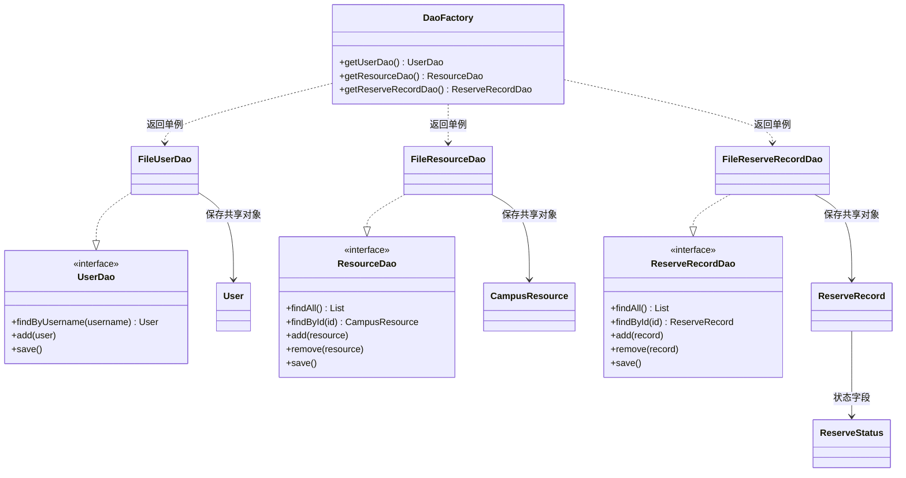

# V3.3 DAO 与实体逐文件答辩问答

本章覆盖 `src/dao`（含 `impl` 子包）的 7 个文件和 `src/entity` 的 4 个文件，共 54 题。初版静态阅读基线为 `21fe14ca8f22416f8a8bf7bc3516f9c45f181c3d`，当时没有运行程序、改变数据文件或重新验证 JDK；本轮已同步 DAO 实现迁包和 User 封装调整。实际验证见 [结构整理实验报告](../../reports/V3.3-面向对象结构整理实验报告.md)，源码中的历史验证注释不能替代本轮运行证据。

先读 [00-阅读导航与核心知识](00-阅读导航与核心知识.md)，建立分层、契约、封装的概念，再按本章逐文件复习。业务权限、预约状态迁移和失败补偿的完整过程见 [02-Service逐文件问答](02-Service逐文件问答.md)；文本格式与转义见 [04-工具类逐文件问答](04-工具类逐文件问答.md)。本章的“可改进”表示设计讨论，不表示项目已经实现。

下表先明确当前实现的共同约定。接口没有写完整的 Javadoc 契约，因此空值、对象共享等细节需要结合实现和调用方确认，不能只凭方法名推断。

| 操作 | 当前文件 DAO 的行为 | 调用方需要知道的边界 |
| --- | --- | --- |
| `findByUsername` / `findById` | 查到时返回内部集合中的实体对象；查不到时返回 `null` | 先判空；修改返回对象会影响 DAO 内存中的对象 |
| `findAll` | 返回新的 `ArrayList`，元素仍指向原实体 | 改副本的增删结构不改原列表；调用实体 setter 会改共享对象 |
| `add` / `remove` | 改内存列表，不立即写文件 | 操作返回不等于数据已持久化；DAO 自身不统一检查权限与业务约束 |
| `save` | 将当前集合交给 `FileUtil` 写回对应文件 | 声明 `IOException`；没有 DAO 级事务、跨文件原子提交或自动回滚 |



## src/dao/DaoFactory.java

**职责：**集中提供三类 DAO 的获取入口，把具体文件实现的选择放在一处。**关键函数：**`getUserDao()`、`getResourceDao()`、`getReserveRecordDao()`。**依赖：**三个 DAO 接口与三个 `File*Dao` 实现；三个服务实现的构造器调用它。源码：[DaoFactory.java](../../../src/dao/DaoFactory.java)。

### D01. `DaoFactory` 属于哪一种工厂，为什么不能直接称为 GoF 工厂方法模式？

本项目可以称为简单工厂式的集中获取入口，也包含静态工厂方法。三个方法直接调用固定实现的 `getInstance()`，没有通过工厂基类与子类的重写来决定创建哪一种产品，因此没有 GoF 工厂方法模式的典型继承结构。它也不是每次调用都创建对象，真正的对象初始化在文件 DAO 中。

这样设计让服务层不用逐处写 `FileResourceDao.getInstance()`，未来替换存储实现时有集中的改动位置。但“有工厂”不等于“符合所有工厂模式”，答辩应先说明实际的创建与获取关系，再给模式命名。

### D02. 返回接口类型如何降低耦合，当前项目是否已经完全实现依赖注入？

`getResourceDao()` 的返回类型是 `ResourceDao`，`ResourceServiceImpl` 也把字段声明为 `ResourceDao`。服务的增删查存代码因而依赖接口，不必知道底层是 `ArrayList` 还是数据库，这体现了面向接口编程与依赖倒置的方向。

不过服务私有构造器仍主动调用静态 `DaoFactory`，工厂又固定选择文件单例，当前没有允许测试代码传入任意 DAO 的构造器。准确结论是“隔离了多数具体存储调用，但创建依赖仍固定”，不能说已经具备完整依赖注入。若将来需要隔离测试，可再考虑构造器注入；这不是当前实现事实。

### D03. 为什么工厂类同时使用 `final`、私有构造器和静态方法？

私有构造器阻止普通调用方通过 `new DaoFactory()` 创建无意义的工厂实例；静态方法允许直接用类名获取 DAO；`final` 明确该类不作为继承扩展点。三者分别约束实例创建、调用方式和继承，不能混为“保证单例”。工厂本身根本没有保存自己的唯一实例。

从软件构造看，这是把不需要对象状态的入口设计成工具式类。若追问能否删掉 `final`，就本类私有构造器而言普通外部子类已经无法正常调用父类构造器，但 `final` 仍把设计意图表达得更直接；它也不会使返回的 DAO 或实体变为不可变对象。

### D04. 工厂能否处理文件损坏并自动切换存储方式？

不能。三个获取方法只有一条返回语句，没有捕获异常、备用实现、配置读取或恢复逻辑。首次调用具体 DAO 的 `getInstance()` 会触发该类初始化，文件加载失败可能由 DAO 的静态代码块转为 `ExceptionInInitializerError`，工厂会让错误继续传播。

因此工厂只承担“选择并返回当前实现”的职责，不承担系统启动恢复。把异常留给上层有助于避免工厂同时处理交互和数据恢复，但当前也意味着存储初始化失败会影响依赖该 DAO 的服务初始化。系统可用性分析应沿真实初始化链说明，不能因为存在接口就推断有自动容错。

## src/dao/UserDao.java

**职责：**定义用户数据访问的最小接口。**关键函数：**`findByUsername(String)`、`add(User)`、`save()`。**依赖：**`User`、`IOException`；由 `FileUserDao` 实现，由 `UserServiceImpl` 使用。源码：[UserDao.java](../../../src/dao/UserDao.java)。

### D05. DAO 是什么，它与数据库、服务层分别有什么区别？

DAO 是数据访问对象，用来隔离“如何保存和查找数据”。数据库是一种存储设施，两者不等同；本项目的 DAO 实际使用内存集合和文本文件，没有 JDBC、SQL 或数据库事务。服务层则处理登录、注册、账号重复等业务规则。

例如 `UserServiceImpl.register()` 先校验账号密码、查重，再调用 `users.add()` 和 `users.save()`。`UserDao` 不定义“密码至少六位”这样的规则，使数据访问接口保持小而明确。若教师问为什么不把所有逻辑写入 DAO，可以从职责变化原因回答：业务规则改变不应迫使文件解析一起修改。

### D06. `findByUsername` 的正常空结果是什么，查不到用户为什么不一定属于 DAO 异常？

当前 `FileUserDao.findByUsername()` 遍历列表，找不到就返回 `null`。这里“没有匹配记录”是可预期的查询结果，不等于文件读取失败。`login()` 将空结果解释为用户不存在并抛出业务异常，`register()` 则把空结果视为可以继续注册的条件。同一个数据结果在两个用例中有不同含义。

从契约角度，接口签名只写 `User`，没有直接表达可空性；目前是实现和调用方共同遵守判空约定。可以通过文档或以后改用 `Optional<User>` 表达，但不能声称当前接口返回 Optional，也不能让调用方在未判空时直接取密码。

### D07. `add` 和 `save` 为什么分开，`throws IOException` 对调用方有什么约束？

`add(User)` 表示向 DAO 当前内存集合加入对象，`save()` 才把整个集合写入文件。分开后，上层可以决定何时提交持久化；同时也产生一个必须理解的中间状态：内存已改、磁盘尚未成功更新。

`IOException` 是受检异常，Java 调用方必须捕获或在方法签名继续声明。当前 `UserServiceImpl.register()` 声明并传播它，而不是由 `add()` 抛出。这个异常契约提醒调用方处理 I/O 失败，但不代表失败时内存会自动恢复，也不代表所有失败都只能是 `IOException`；例如不合法对象还可能触发运行时异常。

### D08. 用户 DAO 为什么没有 `delete`、`update` 和 `findAll`，是否属于接口不完整？

接口应围绕当前用例定义，而不是为了“看起来像完整 CRUD”而添加尚无调用者的方法。现阶段用户业务需要按账号登录、注册查重和新增，因此这三个方法能支持当前流程。接口较小也减少实现类被迫承担无用方法，符合最小接口与接口隔离的思路。

不过“没有 update”不表示用户对象不可修改：查询返回共享的 `User`，调用 setter 后再 `save()` 仍会影响持久化。若以后实现改密或注销，应先明确权限、账号关联和失败恢复，再调整接口；不能把现有可变对象泄露当成已经设计好的账户修改用例。

## src/dao/ResourceDao.java

**职责：**定义校园资源集合的查询、增删与保存操作。**关键函数：**`findAll()`、`findById(String)`、`add(CampusResource)`、`remove(CampusResource)`、`save()`。**依赖：**`CampusResource`、`List`、`IOException`；业务由 `ResourceServiceImpl`、`ReserveRecordServiceImpl` 使用。源码：[ResourceDao.java](../../../src/dao/ResourceDao.java)。

### D09. 为什么 `findAll()` 返回 `List<CampusResource>`，而不是具体的 `ArrayList`？

`List` 表达有序、可重复的集合抽象，泛型参数表达元素应是 `CampusResource`，让编译器帮助发现错误类型的使用。接口不暴露具体集合类，使调用方只依赖遍历、流处理等列表能力，避免把实现细节写进服务契约。

但接口返回 `List` 本身并不承诺只读、线程安全、自动排序或没有重复 ID。当前实现复制列表，资源服务查询时再按 ID 排序；这两个行为来自实现和服务，而非 `List` 类型天然保证。答辩应区分“类型系统保证”和“业务代码实际保证”。

### D10. 为什么资源 DAO 没有 `update`，服务修改资源后为什么只调用 `save()`？

`FileResourceDao.findById()` 返回列表内的同一个 `CampusResource` 引用。`modifyResource()` 获取对象后调用 `setName()`、`setType()`、`setLocation()` 和 `setStatus()`，已经修改了 DAO 内存中保存的对象，所以再调用 `save()` 就会把新字段写入文件。

这依赖的是对象别名与共享可变状态，不是 DAO 自动检测脏数据或 ORM 更新机制。若以后某个实现改为返回实体副本，服务只改副本再 `save()` 就可能不生效。因此可替换性不仅要求方法签名一致，还要求对象所有权、修改如何生效等语义契约一致。

### D11. `remove(CampusResource)` 是否保证按资源 ID 删除，同时清理所有关联预约？

接口名字不能证明这些保证。当前实现调用 `resources.remove(resource)`；实体没有重写 `equals()`，所以实际依赖同一对象引用匹配，而不是比较 ID。资源服务先 `findById()` 得到内部对象再删除，刚好满足这个使用条件。新建一个同 ID 的对象传入不等于能删掉已有对象。

DAO 也不会级联删除预约。`ResourceServiceImpl.deleteResource()` 自己检查有无 `PASS` 预约，有则拒绝删除；其他状态的预约不由此删除。关联一致性是目前由服务进行的部分控制，而不是数据库外键或 DAO 自动维护。

### D12. 如果以后把文件 DAO 换成数据库 DAO，只有实现同名方法就够了吗？

不够。替换需要保持调用方依赖的可观察行为，包括查不到时是否返回 `null`、列表是否可改、返回对象是否共享、`remove` 如何认定目标、`save` 在何时提交数据及失败怎样表现。当前服务特别依赖“取出的对象经 setter 修改后，统一 save 会保存”的行为，常规数据库查询返回的对象不会天然拥有它。

这正是契约与里氏替换原则的实践问题：子类型能编译通过，不代表行为上可直接替换。数据库版本可以实现相同的工作单元语义，也可以重新设计显式更新接口并修改服务，但两者都是后续设计，当前工厂并未提供无成本迁移。

## src/dao/ReserveRecordDao.java

**职责：**定义预约记录的数据访问操作，不承载预约审批规则。**关键函数：**`findAll()`、`findById(String)`、`add(ReserveRecord)`、`remove(ReserveRecord)`、`save()`。**依赖：**`ReserveRecord`、`List`、`IOException`；主要被预约服务使用，也被资源服务用于检查已通过预约。源码：[ReserveRecordDao.java](../../../src/dao/ReserveRecordDao.java)。

### D13. 为什么 DAO 不直接定义“通过预约”和“取消预约”方法？

通过和取消是业务用例，不只是修改一条数据。审核通过涉及管理员权限、允许的状态迁移、时间冲突和资源占用；取消涉及本人权限，以及是否应释放资源。把这些语义放进只访问预约记录的 DAO，会让它依赖用户、资源和交互规则，削弱职责边界。

当前接口只提供记录访问，`ReserveRecordServiceImpl` 协调多个 DAO 完成用例。代价是 DAO 本身无法阻止调用者直接把实体状态设为非法值，因此该分层依赖正确的服务入口。详细的状态迁移条件与补偿顺序见 [02-Service逐文件问答](02-Service逐文件问答.md)。

### D14. 预约查询为什么先 `findAll()` 再在服务过滤，有什么优点和成本？

现阶段记录量小，接口保持通用即可。服务把“查我的预约”“查待审核”“按资源 ID 或状态查”等业务条件写成 Stream 过滤，DAO 不必为每个菜单条件增加方法。这样同一数据访问操作能支持多个用例，也便于课程中展示集合与流的使用。

成本是当前每次 `findAll()` 都复制整个列表，过滤还要遍历，时间和额外空间都随记录数增长。它没有索引或分页，不适合据此宣称支持大规模查询。若规模增长，可把稳定的数据查询条件下推到 DAO；是否需要改造应由真实负载决定。

### D15. 接口中的 `remove` 是学生“取消预约”的实现方式吗？

不是。取消预约调用服务的状态更新逻辑，把 `ReserveStatus` 改成 `CANCEL` 后保存，从而保留历史记录。当前 `records.remove(record)` 的重要使用点是 `addAndSaveReserve()`：新增后保存失败时，删除刚加入内存的对象，撤回本次未成功提交的新增。

这体现了“物理移除”和“业务状态变更”的区别。系统分析时，取消用例通常还需要可查询的历史，因此不能简单等同于删除数据；软件构造时，回滚移除则是异常路径的内存修复。两者虽然都可能出现在失败或撤销场景，目的和数据效果不同。

### D16. `ReserveRecordDao.save()` 能保证预约与资源状态同时成功保存吗？

不能。这个接口只保存预约集合，没有接受资源集合或事务对象，也没有 `begin`、`commit`、`rollback` 协议。资源状态由另一个 `ResourceDao` 保存，所以“预约变为 PASS”与“资源变为 OCCUPIED”跨越两次独立文件写入。

当前服务先保存预约，再按需要保存资源；失败时尝试恢复内存字段，并在必要时重写预约文件。这属于业务层的补偿处理，不是数据库式原子事务。第二次写入、补偿写入乃至进程中断都可能留下限制，不能用 DAO 接口中的一个 `save()` 推导出跨文件 ACID 保证。

## src/dao/impl/FileUserDao.java

**职责：**以进程内用户列表提供访问，并委托 `FileUtil` 加载、保存 `user.txt`。**关键函数：**静态初始化块、私有构造器、`getInstance()`、`findByUsername()`、`add()`、`save()`。**依赖：**`UserDao`、`User`、`FileUtil`、`List`。源码：[FileUserDao.java](../../../src/dao/impl/FileUserDao.java)。

### D17. 这个单例为什么称为饿汉式，它究竟何时读取文件？

`INSTANCE` 在类的静态初始化块中通过私有构造器创建，构造器马上执行 `FileUtil.loadUsers()`。因此它是在类初始化阶段构造实例，而不是在 `getInstance()` 方法体内判断空值再创建的懒汉式写法。普通调用方只能通过公开入口取得同一实例。

这里的“饿汉”不等于 JVM 一启动就立即读取所有 DAO 文件：类通常在首次主动使用时才初始化，例如首次调用 `FileUserDao.getInstance()`。加载成功后，后续 getter 不会重新读取文件。这也解释了为什么同一进程内两个服务调用能共享用户列表。[Java 8 类初始化规则](https://docs.oracle.com/javase/specs/jls/se8/html/jls-12.html#jls-12.4.1)

### D18. 静态初始化读文件失败会发生什么，为什么不能只按普通 `IOException` 理解？

构造器声明 `throws IOException`，静态块捕获它后显式抛出 `new ExceptionInInitializerError(e)`。这样原始原因被保留，但错误发生在类初始化阶段，调用方不会收到该构造器直接抛出的受检异常。该错误属于 `Error`，普通的 `catch (Exception)` 也不能将它一概捕获。

更关键的是，初始化失败的类会进入错误状态；在同一类加载器中，后续主动使用可能得到 `NoClassDefFoundError`，不会每次调用 getter 都自动重新读文件重试。答辩中应把“修复文件”与“恢复当前初始化链”区分开，而不能声称保存异常处理能覆盖启动失败。[Java 8 初始化失败处理](https://docs.oracle.com/javase/specs/jls/se8/html/jls-12.html#jls-12.4.2)

### D19. `findByUsername()` 的时间复杂度和空值边界分别是什么？

代码逐个检查 `user.getUsername().equals(username)`，最坏需要访问全部用户，因此是 O(n) 的线性查询，不是按账号建立哈希索引。它找到第一个相等账号就返回，所以如果集合里出现重复账号，查询不会自动发现或合并重复项。

如果已存用户名非空，传入 `null` 只会比较失败；但若内部含 `null` 用户或用户名为 `null` 的对象，表达式可能抛出空指针异常。服务注册入口检查账号，DAO 自身的 `add` 却没有同样防护。因此“正常调用路径校验过”不等于“该公有方法能接受任意输入”。

### D20. `private final List<User> users` 是否意味着用户列表或用户对象不可修改？

`private` 限制外部直接访问这个字段，`final` 限制字段初始化后不能再指向另一个列表；它们并不禁止 `users.add()`，也不禁止修改列表中 `User` 的字段。`findByUsername()` 又直接返回内部实体，外部拿到它后可以调用 `setRole()`、`setPassword()`。

因此这里封装了“列表字段的访问入口”，没有实现“数据的不可变性”或完整表示独立性。好处是服务修改实体方便，风险是对象引用可以绕过预期的业务校验。追问改善方案时可讨论受控更新方法或不可变快照，但应明确当前代码没有采用这些方案。

### D21. 单例是否天然线程安全，两个线程同时注册同一个账号会怎样？

Java 类初始化提供初始化阶段的协调，解决的是实例构造与发布问题；它不会自动同步实例后续的方法。本类的列表来自普通 `ArrayList`，查询、增加和文件保存没有锁。更高层的“查重—新增—保存”还是多步操作，两个线程可能都查不到账号后分别添加。

因此不能把“单例唯一”当作“操作原子”。即使将列表换成同步包装，多步业务操作及文件写入仍需单独考虑一致性。当前控制台流程未表现为并发服务，课程范围内可以说明使用前提，但不能声称具备多线程注册安全。[Java 8 ArrayList 的同步说明](https://docs.oracle.com/javase/8/docs/api/java/util/ArrayList.html)

### D22. 注册保存失败时，用户是否一定没有创建，重新注册会发生什么？

当前 `UserServiceImpl.register()` 依次执行 `users.add(user)`、`users.save()`，没有捕获保存失败后移除用户。因此若 `save()` 抛出异常，新用户仍可能留在当前进程内存中；后续注册同名账号会被查重逻辑认定已存在，登录也可能查到这个尚未可靠落盘的对象。

磁盘情况则不能简单说“保持旧文件”：`FileUtil.saveUsers()` 直接打开输出流覆盖写入，失败可能发生在不同阶段。这里暴露的是内存状态与持久化状态不一致的风险。预约新增有自己的内存补偿，不应把那部分机制误归到所有 DAO 或用户注册上。

## src/dao/impl/FileResourceDao.java

**职责：**管理共享资源列表，按 ID 查询，并委托工具类加载、保存资源文件。**关键函数：**静态初始化、`findAll()`、`findById()`、`add()`、`remove()`、`save()`。**依赖：**`ResourceDao`、`CampusResource`、`FileUtil`、`ArrayList`。源码：[FileResourceDao.java](../../../src/dao/impl/FileResourceDao.java)。

### D23. `findAll()` 为什么创建新列表，这是不是深拷贝？

`new ArrayList<CampusResource>(resources)` 创建新的列表容器，并把原列表中的对象引用放进去。所以调用方对返回列表执行 `clear()`、`add()` 或排序，不会直接改变 DAO 原列表的成员结构与顺序，这为集合结构提供了一层防御。

但元素没有逐个复制，两个列表仍引用同一批 `CampusResource`。执行 `result.get(0).setStatus("DISABLED")` 会改变 DAO 内存中的资源。这是浅拷贝，不能称为深拷贝、不可变快照或完全隔离；仅改列表包装也无法消除实体引用的共享。[Java 8 ArrayList 集合构造器](https://docs.oracle.com/javase/8/docs/api/java/util/ArrayList.html#ArrayList-java.util.Collection-)

### D24. `findById()` 为什么返回原对象，答辩时如何解释它的收益与对象泄露？

查找循环匹配 `resource.getId().equals(id)` 后直接返回该对象，因此服务修改返回对象就能修改 DAO 维护的状态。`ResourceServiceImpl.modifyResource()` 和预约审批设置资源占用都利用了这一点，不需要再把对象交回某个 `update()` 方法。

同一特性也让持有引用的调用者有能力修改 ID、状态等重要字段，即使它没有经过服务验证。对象泄露不是指密码泄露，而是内部可变表示暴露给外部。它让实现简单，却把正确使用责任部分交给调用方；以后改为复制对象时，也必须同步调整更新契约。

### D25. `remove()` 为什么可能出现“字段一模一样却删不掉”的情况？

`resources.remove(resource)` 使用元素相等判断，`CampusResource` 没有重写 `equals()`，继承的对象相等行为实质上按引用身份判断。因此两个分别 `new` 出来的资源，即使 ID、名称等字段相同，也不是同一个对象。当前服务先查出原对象再删除，所以正常删除路径能匹配。

若未来改成按 ID 删除，可直接提供 `removeById` 或认真定义实体相等性。但若把可变 ID 用于 `equals()`、`hashCode()`，对象进入哈希集合后再改 ID 会带来额外问题，不能为了修补一个调用就草率增加相等方法。当前也忽略 `List.remove` 的布尔返回值，不报告目标未找到。

### D26. 资源什么时候从文件加载，运行中手工编辑 `resource.txt` 会立刻生效吗？

资源列表只在 DAO 的私有构造器中由 `loadResources()` 初始化一次。后续 `findAll()`、`findById()` 都查询内存，`save()` 则把当前内存集合写回文件，没有重新加载、文件监听、时间戳检查或合并外部修改的步骤。

所以运行中手工改文件通常不会立即改变查询结果，后续保存还可能把外部改动覆盖。这体现了两个状态副本：运行时内存集合和持久化文件。它不是支持多进程一致性的缓存系统；讨论部署约束时，应说明当前模型适用于由一个进程掌握数据的简单场景。

### D27. 文件保存是追加单条资源还是重写全部资源，这对失败恢复有什么影响？

`FileResourceDao.save()` 把整个 `resources` 列表传入 `FileUtil.saveResources()`。工具类使用未开启追加模式的 `FileOutputStream`，再遍历所有资源写行，因此是整份重写，而不是只追加新资源或只更新变化字段。理解这一点才能解释删除为什么也靠同一个 `save()` 生效。

这种方案实现简单，但一次保存成本随资源数增长，写入中断也可能影响整份文件。当前没有临时文件成功写完后再替换的机制，不能把“try-with-resources 会关闭流”误解为“写入天然原子”。关闭资源与失败时保留完整旧版本是不同保证。

### D28. 新增和修改资源失败时，DAO 是否能恢复旧内存状态？

不能。DAO 的 `add()`、`remove()`、实体 setter 和 `save()` 之间没有记录旧值或统一的提交边界。资源服务新增后直接保存，修改时直接更改共享实体再保存，删除时先移除再保存；这些方法本身没有与预约状态更新相同的恢复代码。

例如修改资源名称后保存失败，调用方收到失败不代表内存中的名称已经复原。对测试设计而言，应分别观察返回/异常、内存查询和重启后读取的数据，三者可能不同。这是从异常安全角度分析操作后置状态，不是在断言每次 I/O 失败都一定造成同一种损坏。

## src/dao/impl/FileReserveRecordDao.java

**职责：**保存进程内预约记录集合，提供流式 ID 查询，委托工具类读写预约文件。**关键函数：**静态初始化、`findAll()`、`findById()`、`add()`、`remove()`、`save()`。**依赖：**`ReserveRecordDao`、`ReserveRecord`、`FileUtil`、`ArrayList` 与 Java Stream。源码：[FileReserveRecordDao.java](../../../src/dao/impl/FileReserveRecordDao.java)。

### D29. `stream().filter().findFirst().orElse(null)` 每一步分别做什么？

`records.stream()` 为集合创建顺序流，`filter` 声明保留记录 ID 相等的元素，终止操作 `findFirst()` 开始求值并返回第一个匹配的 `Optional<ReserveRecord>`；`orElse(null)` 再把空 Optional 转成接口当前约定的 `null`。流只负责查询，没有复制实体，也没有删除不匹配记录。

`findFirst` 可在找到匹配后短路，但最坏仍需遍历全部记录，所以复杂度仍是 O(n)，不能把函数式写法说成自动有索引。这里用的是 `stream()`，不是 `parallelStream()`；代码简洁也不等于自动并行或线程安全。

### D30. 如果记录 ID 重复，查询和持久化会怎样，唯一性到底由谁保证？

本 DAO 的 `add()` 直接加入列表，不检查重复；`findById()` 只返回第一个匹配项。正常新增路径由服务的 `generateReserveId()` 生成 UUID，并反复查询避免与当前已有 ID 相同；加载文件时，`FileUtil.parseReserveRecord()` 又借助 `Set` 拒绝空 ID 和重复 ID。

这些是不同边界上的检查，不是 DAO 中的唯一约束。若绕过服务直接加入同 ID 记录，当前 `save()` 不会重新执行加载时的查重检查，写出的文件可能到下次启动才被拒绝。不能把 UUID 的低碰撞概率、服务校验与数据库唯一索引混为一谈。

### D31. 为什么预约列表副本也不能视为某一时刻稳定不变的历史快照？

`findAll()` 和资源 DAO 一样复制列表结构，而没有复制 `ReserveRecord`。服务筛选“我的预约”后收集得到的新列表，里面仍是同一批记录对象。随后审核把对象状态从 `PENDING` 改为 `PASS`，先前取得的列表若仍持有该对象，再读取状态就可能看到新值。

因此当前返回值是共享实体的查询结果，而非不可变历史快照。它便于界面立即使用最新字段，但若未来需求是导出“审核前的数据”或做一致的审计快照，就需要明确复制时机与字段范围。当前没有版本号、快照隔离或历史变更日志。

### D32. 保存失败后删除新记录为何能恢复内存，它又恢复不了什么？

`addAndSaveReserve()` 先把新对象交给 `records.add()`，保存失败被包装成业务异常后，再把同一对象传入 `records.remove()`。由于实体没有重写 `equals()`，这里依靠对象身份仍然可以找到刚加入的记录，实现撤回本次内存新增。

但这个处理发生在服务层，DAO 自身没有自动回滚。而且移除内存元素不等于恢复磁盘旧文件：一次覆盖写入可能已经截断文件或写入部分内容。异常安全应分别讨论内存与外部资源，不能把“集合恢复了”扩大成“整个提交具有原子性”。

### D33. 服务恢复预约状态时为什么不用重新查对象或重新 `add()`？

服务拿到的记录就是 DAO 列表里的对象。`updateReserveStatus()` 先记录旧状态、旧驳回原因、旧审核时间，再修改同一对象；捕获保存异常时对这个对象调用 setter 恢复即可，列表引用一直指向它，无需删掉重建或再次添加。

这展示了对象身份稳定对补偿代码的帮助，也展示了共享可变状态带来的耦合。恢复只覆盖该方法保存过的字段，不是通用对象快照机制；关联资源状态也由单独变量恢复。完整失败路径还可能需要第二次写预约文件，具体限制见 [02-Service逐文件问答](02-Service逐文件问答.md)。

### D34. 从 Service 到 DAO 再到文件，一次完整新增预约调用如何串起来？

实际入口 `submitReserve()` 先校验学生权限、资源、时间和冲突，再构造 `PENDING` 的记录，调用私有 `addAndSaveReserve()`。后者依次调用 `records.add()`、`saveReserves()`，最终到 `FileReserveRecordDao.save()` 和 `FileUtil.saveReserves()`。DAO 负责数据集合与保存委托，格式转换在工具类，业务规则在服务。

下面是便于解释 DAO 契约的完整方法示例，不是新增源码，也未运行；调用者应已完成业务校验。它对应现有服务的新增与失败移除思路，但直接传播 `IOException`，省去了服务的异常包装。即使内存移除成功，文件写入失败仍不保证磁盘原样恢复。

```java
import dao.DaoFactory;
import dao.ReserveRecordDao;
import entity.ReserveRecord;
import java.io.IOException;

public final class ReserveDaoWalkthrough {
    private ReserveDaoWalkthrough() {
    }

    public static ReserveRecord addValidatedRecord(ReserveRecord record)
            throws IOException {
        ReserveRecordDao records = DaoFactory.getReserveRecordDao();
        if (records.findById(record.getRecordId()) != null) {
            throw new IllegalArgumentException("预约记录 ID 已存在");
        }
        records.add(record);       // 只改变当前进程内存中的列表
        try {
            records.save();        // 委托 FileUtil 写入 reserve.txt
        } catch (IOException e) {
            records.remove(record); // 撤回刚才的内存新增
            throw e;
        }
        return records.findById(record.getRecordId()); // 返回共享实体
    }
}
```

该示例把入口参数满足实体字段约束作为前提，不能替代正式服务；它不处理并发查重，也没有宣称跨文件事务。

## src/entity/User.java

**职责：**承载账号、密码、角色、注册时间等用户数据，并封装密码匹配行为。**关键函数：**无参/全参构造器、四组 getter/setter、`matchesPassword()`、`toString()`。**依赖：**`LocalDateTime`；被用户 DAO、登录注册服务以及权限检查使用。源码：[User.java](../../../src/entity/User.java)。

### E01. 使用私有字段和 getter/setter 是否就完成了“良好封装”？

私有字段隐藏了直接存储访问，但封装还要求通过公开操作维护对象不变式，例如账号非空、角色合法。当前 setter 和全参构造器都直接赋值，没有校验，调用 `setRole("unknown")` 或 `setUsername(null)` 在实体层不会被拒绝；无参构造器还会留下全部字段为 `null`。

当前正常注册依赖服务检查账号、密码并固定使用 `student` 角色，所以业务入口有部分约束。登录通过 `matchesPassword` 请求用户对象比较密码，服务不再取出密码自行比较；该方法对非空输入作精确字符串比较，不改变大小写、空格或长度。实体因此封装了一项行为，但仍没有自行维护完整业务不变式。封装强弱应看公开方法允许产生哪些状态，不能只统计 `private` 的数量。

### E02. 角色使用字符串而预约状态使用枚举，有什么实际取舍？

`User.role` 是 `String`，服务通过 `"admin".equals(user.getRole())`、`"student".equals(...)` 判断权限。字符串与文件字段转换直接，适合当前小型实现；但拼写错误和任意文本仍能进入实体，编译器不会阻止 `"studnet"`。把常量放在 equals 左边只能防止角色为 null 时该次比较抛异常，不能验证角色合法。

枚举可以把合法角色集合变成类型的一部分，但需要调整实体、服务、文件读写和兼容策略。当前没有 `Role` 枚举，也没有基于角色的权限表。答辩可说明这是模型一致性上的改进方向，而不能把字符串比较描述成完整 RBAC 框架。

### E03. `User.toString()` 为什么不再输出密码，持久化是否依赖它？

本轮已从 `toString()` 中移除 `password`，只展示用户名、角色和注册时间。因此直接打印用户或包含该用户的 `Result` 时，不会再经此字符串表示输出密码。这是明确的显示行为变化，旧版报告中的真实运行输出仍按当时版本保留。

文件持久化并不调用 `toString()`，而是 `FileUtil.saveUsers()` 逐个取 getter 写字段；`getPassword()` 因此仍保留。密码本身仍按字符串写入，`matchesPassword` 也只比较输入与保存值，当前没有密码哈希存储。展示隐藏与凭据安全存储是两个不同问题，仅修改 `toString()` 不会改变文件中的明文密码。

### E04. 注册时间为何选 `LocalDateTime`，getter 直接返回它是否像返回可变集合一样危险？

`LocalDateTime` 表达不含时区的日期时间，注册时由服务使用 `LocalDateTime.now()` 赋值，文件层用 `toString()` 与 `parse()` 转换。它是不可变值类型，调用 `plusDays()` 等方法会得到新值，因此 getter 返回该时间对象不会让调用者直接修改原对象内部的时间值。

但 `User` 仍可通过 `setRegisterTime()` 替换字段，所以用户实体并未因此不可变。此外，`LocalDateTime` 自身不记录时区或全球唯一时刻；当前统一校园场景可采用本地时间约定，不能声称已解决跨时区时间语义。[Java 8 LocalDateTime 文档](https://docs.oracle.com/javase/8/docs/api/java/time/LocalDateTime.html)

### E05. 无参构造器、全参构造器和 `toString()` 分别服务什么目的，是否等于 Java 序列化？

全参构造器让注册和文件读取可以一次提供四个字段；无参构造器允许分步创建和赋值，但当前源码没有表明存在某个 ORM 或反射框架强制要求它。`toString()` 则方便人工观察对象，不是严格的文件格式协议，也不承担解析或验证职责。

本类没有实现 `Serializable`，项目保存用户是自定义文本字段编码，而不是 `ObjectOutputStream` 的 Java 对象序列化。因此不能把“有无参构造器、有 getter/setter、能写文件”自动推导为“已经使用 Java 序列化框架”。这些机制应从实际调用工具和接口判断。

## src/entity/CampusResource.java

**职责：**承载资源 ID、名称、类型、状态、位置和说明。**关键函数：**无参/全参构造器、六组 getter/setter、`toString()`。**依赖：**字段均为 `String`；资源服务与预约服务共同使用它。源码：[CampusResource.java](../../../src/entity/CampusResource.java)。

### E06. 从系统分析角度，为什么资源 ID 与资源名称应分成两个字段？

名称是供人理解和搜索的描述，可能重复也可能修改；ID 用来稳定识别某一资源。当前资源服务生成 UUID 作为 ID，按名称查询使用 `contains()`，预约记录则保存资源 ID 而不是名称。因此“把会议室改名”不需要同步改写每条预约中的名称关联。

不过当前 `id` 仍有公开 setter，实体并未从类型上阻止修改身份。若调用者改掉 ID，已有预约中的字符串不会自动跟随。系统分析模型把标识与描述区分开是必要步骤，软件实现还需要明确标识何时可变；当前正常资源修改流程没有调用 `setId()`。

### E07. `status` 和 `type` 都是字符串，为什么它们的业务含义不能混在一起？

`type` 描述资源类别，`status` 表达当前能否使用；同一类别可以有不同状态。当前资源服务仅把状态校验为 `AVAILABLE`、`OCCUPIED`、`DISABLED`，没有对 `type` 建立类似枚举检查。二者虽然使用同一 Java 类型，却代表不同领域概念。

从建模角度，字段类型相同不代表可互换。服务用状态决定学生是否可见及是否可预约，而名称、类型、位置用于描述资源。若未来引入类型枚举，应先明确课程要求中的类别集合；不能因为已有预约状态枚举就随意补造“教室、体育馆”等当前未约束的分类规则。

### E08. 资源状态为什么不能简单等同于某一条预约的状态？

`CampusResource.status` 描述资源，`ReserveRecord.status` 描述申请流程。资源为 `OCCUPIED` 时，关联记录可能有一条或多条已通过预约，也可能同时存在待审核和被驳回记录。服务审核通过时设置资源为 `OCCUPIED`；取消最后一条通过预约时才尝试恢复 `AVAILABLE`。

当前模型还同时存在时间区间冲突检查与全局资源状态门槛，因此不是完整的按时段可用性日历。实体只保存一个资源状态字符串，并不自动根据所有预约实时计算。答辩应说明这两个状态空间如何由服务协调，不能把资源实体说成能自行判断某一时段是否空闲。

### E09. 为什么资源对象看起来只有数据，没有判断“能否删除”的方法？

当前实体属于以数据承载为主的模型，删除规则集中在服务：先确认管理员，再查资源，再检查是否存在已通过的预约。判断需要访问另一类记录集合，如果直接放进这个实体，可能迫使实体依赖 DAO 或由调用者传入额外上下文。

这样的贫血模型在小型分层课程项目中容易理解，但业务越复杂，服务就可能越来越大。另一种设计是让实体承载局部规则、由领域服务协调跨对象规则；这是可讨论的演进方向。不能只凭“没有业务方法”认定代码错误，也不能把当前模型描述为丰富领域模型。

### E10. 构造器参数顺序、可空字段与 `toString()` 如何影响正确性和可维护性？

全参构造器连续接收六个字符串，编译器不能识别“把状态与位置传反”这种语义错误；当前文件加载严格按字段位置调用，新增服务也显式传入 `AVAILABLE`。理解调用处的参数对应关系比只背字段名称更重要。

实体没有验证 null，`toString()` 能把 null 拼成文本，但保存时 `FileUtil.escape()` 会访问字符串长度，因此“可以打印”不等于“可以持久化”。无参对象若没补齐字段就保存，可能出现运行时异常。可改进方式包括更明确的构造入口或字段验证，但当前没有 Builder，也没有自动校验注解。

## src/entity/ReserveRecord.java

**职责：**承载一次预约的身份、关联标识、申请时间、预约区间、处理状态、备注和审核信息。**关键函数：**八参数构造器、十组 getter/setter、`toString()`。**依赖：**`LocalDateTime`、`ReserveStatus`；文件工具负责兼容旧记录，预约服务负责迁移与校验。源码：[ReserveRecord.java](../../../src/entity/ReserveRecord.java)。

### E11. 为什么记录保存 `resourceId` 和 `applicantUsername`，而不是直接保存 `CampusResource`、`User` 对象？

这是用标识表达关联。文本文件可以直接保存字符串，加载预约时也不必同时构造完整用户和资源对象图；需要资源数据时，服务再用 `resources.findById(record.getResourceId())` 查询。它降低了直接对象依赖，也避免在每条记录中重复保存整份资源信息。

代价是 Java 类型系统不会检查关联是否仍存在，也没有数据库外键。资源被删除后，某些历史预约仍可能保留原 ID，服务在审核或取消特定记录时必须处理关联资源缺失。画类图可以表示领域关联，但应标注实现使用 ID，不能画成代码中实际持有资源对象字段。

### E12. 四类时间字段为何不能合并，`auditTime == null` 表达什么？

`applyTime` 是提交申请的时间，`reserveStartTime`、`reserveEndTime` 是要使用资源的时间区间，`auditTime` 是处理审核的时间。它们对应不同业务事件：今天提交、明天审核、后天使用是完全正常的，因此不能用申请时间替代预约开始，也不能用预约结束替代审核时间。

`auditTime` 可空，既可能表示尚未审核，也可能表示从旧版八字段文件加载时没有历史审核信息。`toString()` 在空值时显示“未记录”，比直接补造一个当前时间更真实。因此只看 auditTime 是否为空，不能可靠反推记录一定是 PENDING，还应结合状态与数据来源。

### E13. 预约状态机是不是在实体中实现的，枚举字段为何仍不能防止非法迁移？

不是。`setStatus(ReserveStatus status)` 只是赋值，甚至允许传入 `null`；它不会检查原状态，也不会阻止 `REJECT` 重新变为 `PASS`。真正允许的迁移写在 `ReserveRecordServiceImpl.requireTransition()`：`PENDING` 可到 `PASS`、`REJECT`、`CANCEL`，`PASS` 可到 `CANCEL`。

枚举约束的是取值种类，状态机约束的是变化路径，两者属于不同层面的不变式。当前正确性依赖经服务入口操作。若将来把转换做成实体的 `approve()` 等行为，还要考虑权限、资源冲突等跨对象检查；不能只搬一个 setter 就说完成领域封装。

### E14. 为什么 `rejectReason` 默认是空字符串，八参数构造器没有接收审核字段？

新申请提交时尚未审核，不需要提供驳回原因和审核时间，因此 `rejectReason` 字段初始化为 `""`，`auditTime` 保持 `null`，八参数构造器填入申请本身的数据。审核通过或驳回时，服务再设置原因与审核时间；通过时原因设为空，驳回时要求非空原因。

这个设计也配合文件兼容：旧版八字段记录缺少审核信息，读取后保留默认空值，不捏造历史。新版十字段记录再经 setter 补齐后两项。默认值减少正常路径的分支，但实体 setter 仍可接受 null，所以保存工具还对备注和驳回原因做了空值转换。

### E15. 实体能保证预约开始早于结束、结束不早于当前时间吗？

不能。构造器和时间 setter 都直接赋值，合法区间由服务 `validateSubmission()` 检查；冲突检测也在服务根据其他 `PASS` 记录进行。实体只是保存数据，因此单独构造开始晚于结束的对象不会立即失败，文件读取也不等于重新执行全部提交业务规则。

从软件构造看，这要求明确哪些不变式由哪一层维护。从系统分析看，时间重叠采用 `start < otherEnd` 且 `otherStart < end`，端点刚好相接不算冲突，语义接近半开区间。该规则并不是 `LocalDateTime` 类型天然提供，也不在本实体内部实现。

### E16. `recordId`、对象身份与状态历史有什么区别，当前实体保留了哪些历史？

`recordId` 是业务标识，用于查找一条预约；对象身份是 JVM 中某个实例，两个实例即使 recordId 相同也不是自动相等，因为本类未重写 `equals()`。服务中排除当前记录时使用 `other != record`，正是利用共享内存中的对象身份。

实体保存当前状态、申请时间、最近一次审核信息，取消时服务保留已有审核信息；它没有保存所有状态变化列表、每次操作人或独立取消时间。因此它支持查询当前记录和部分审核信息，但不能称为完整事件日志或完整审计轨迹。业务标识、对象引用与历史记录模型应分别解释。

## src/entity/ReserveStatus.java

**职责：**定义预约状态的封闭取值集合。**关键成员：**`PENDING`、`PASS`、`REJECT`、`CANCEL`；编译器提供 `values()`、`valueOf(String)` 等枚举能力。**依赖：**被 `ReserveRecord`、服务和 `FileUtil` 使用，本文件不定义业务方法。源码：[ReserveStatus.java](../../../src/entity/ReserveStatus.java)。

### E17. 为什么预约状态用枚举比直接用字符串更有表达力，枚举保证到什么程度？

声明 `ReserveStatus` 后，字段与参数在编译期就表达“这是预约状态”，正常赋值只能使用该枚举的常量或 null，不会把任意字符串误当状态。`PENDING` 表示待审核，`PASS` 表示通过，`REJECT` 表示驳回，`CANCEL` 表示取消，名称与业务语义对应。

但类型只限定可能值，不验证状态迁移、权限或关联资源。例如 `setStatus(ReserveStatus.PASS)` 在实体层仍可跳过审核规则。因此枚举提供的是类型安全的一部分，不能替代业务状态机。四种含义与迁移路径应结合服务说明，而不是只背常量列表。

### E18. 为什么服务可以用 `==` 比较枚举，而字符串角色通常用 `equals()`？

每个枚举常量在对应枚举类型中有唯一的常量实例，因此用 `record.getStatus() == ReserveStatus.PASS` 就能判断是否为这个常量，左边为 null 时也只得到 false。字符串的引用身份和文本内容不同，相同文本可能来自不同对象，所以角色比较使用 `equals()` 更合适。

这不是说所有对象都能用 `==` 比值，也不是说枚举的 `equals()` 错误；两者对非空枚举常量比较都能表达相等。需区分类型的身份语义，不能把本项目对 enum 的写法机械迁移到账号、资源 ID 或时间值上。[Java 8 Enum 文档](https://docs.oracle.com/javase/8/docs/api/java/lang/Enum.html)

### E19. `valueOf()` 和 `name()` 怎样把文本状态与枚举连接起来，非法输入如何处理？

保存预约时，`FileUtil.saveReserves()` 调用 `record.getStatus().name()` 写出声明名称；加载时调用 `ReserveStatus.valueOf(fields.get(6))` 还原。管理员按状态查询也使用 `valueOf(value)`，非法名称由服务捕获 `IllegalArgumentException` 后转成业务错误；文件解析则将相应运行时异常包装为 `IOException`。

`valueOf` 要求名称匹配，`pass`、`PASS ` 不会自动等同 `PASS`。本枚举没有重写 `toString()`，但持久化明确使用 `name()`，把显示文本与稳定标识区别开。不能声称枚举能自动修正大小写或去掉空格。[Java 8 Enum.name/valueOf 文档](https://docs.oracle.com/javase/8/docs/api/java/lang/Enum.html)

### E20. 未来增加一个状态或重命名枚举常量，是只改这个文件就能完成吗？

不能。新增常量只是扩展类型定义，还需检查状态迁移、查询提示、资源占用判断、取消规则、文件解析与历史数据兼容。例如增加“已完成”后，是否仍占用资源、能否取消、何时进入该状态，都需要用例和规则说明，当前没有自动定时完成机制。

当前持久化保存枚举名称，重命名 `PASS` 会让旧文件中的 `PASS` 无法直接通过新 `valueOf()` 解析，因此这是数据格式变更。保存名称比保存顺序编号更容易理解，但仍需要版本兼容设计。也不能依据 `ordinal()` 大小推导合法迁移：枚举声明顺序不是业务状态机。
