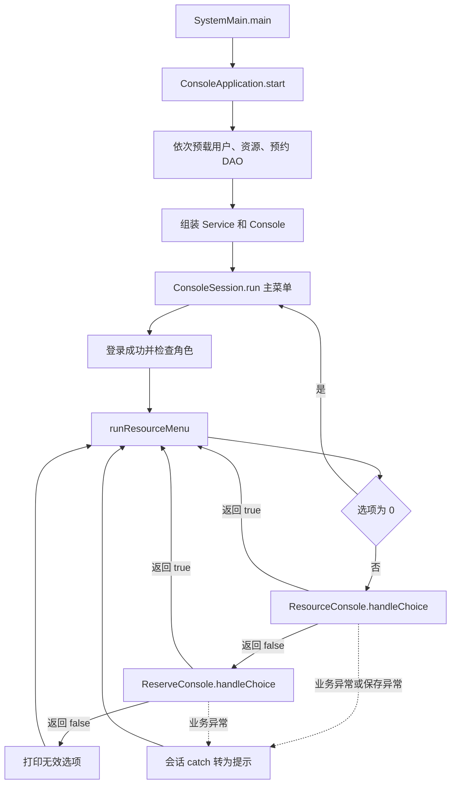
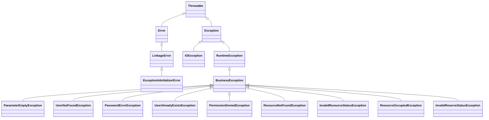

# V3.3：UI 与异常逐文件答辩问答

本篇覆盖 `src/ui/console/` 的 6 个文件和 `src/exception/` 的 10 个文件。依据源码版本 `21fe14ca8f22416f8a8bf7bc3516f9c45f181c3d` 阅读整理；题目中的测试场景是建议验证方法，未把静态分析写成已经执行的测试。涉及 Service 的触发条件以对应实现为准，配合 [Service 逐文件问答](02-Service逐文件问答.md) 阅读。

UI 负责读取、分派和呈现，Service 负责业务规则，DAO 负责数据访问。下图体现当前控制台的实际路径；异常沿调用栈向上交给会话边界处理，不需要每个读取方法各写一套 `try/catch`。

## src/ui/console/SystemMain.java

源码：[SystemMain.java](../../../src/ui/console/SystemMain.java)。职责是公开启动入口，关键方法只有 `public static void main(String[] args)`；直接依赖同包 `ConsoleApplication`，不读取文件、不处理账号、不分派业务菜单。

### U01. 为什么 main 必须采用当前的 public static void main(String[] args) 形式？

在本项目的 Java 8 启动方式中，启动器以约定签名查找入口：`public` 使入口可被调用，`static` 让入口不依赖预先创建 `SystemMain` 对象，`void` 表示没有 Java 返回值，`String[] args` 接收命令行参数。参数名可以改，签名中的参数类型不能随意改。当前方法未使用 `args`，不代表参数声明可以删除；方法内部只委托 `ConsoleApplication.start()`，进程退出状态也不是通过给 `main` 返回整数设置的。同名方法可以重载，但其他参数形式不会因此自动成为启动入口。

### U02. 只有一行委托的入口是不是多余，为什么不把所有逻辑写进 main？

这行委托让“程序如何被启动”和“应用如何组装并运行”各有边界。`SystemMain` 保持稳定的公开入口，`ConsoleApplication` 集中处理预加载和对象组装，`ConsoleSession` 负责交互循环。这里体现单一职责与信息隐藏，但不应夸大为复杂框架或完整 MVC。它的直接好处是修改控制台流程时不必改入口，也能从调用关系快速定位启动失败、登录失败或业务失败属于哪一层。

### U03. package ui.console 与源文件目录有什么关系，为什么启动时要用完整类名？

`package ui.console` 声明类的命名空间，完整类名是 `ui.console.SystemMain`。源文件位于 `src/ui/console/`，与包名对应，编译后也应保持相应目录结构。运行时类路径应指向包含顶层 `ui` 目录的位置，然后指定完整类名；不能把源文件路径直接当作 Java 8 的主类名。包不仅用于整理目录，还决定无修饰符成员的访问边界，所以同包的入口能调用非公开的 `ConsoleApplication.start()`。类路径负责查找位置，包名负责类的身份，二者不能互相替代。

### U04. 为什么 SystemMain 是 public，而其他控制台类大多是 final 且没有 public？

入口需要明确对外暴露，其余控制台类没有访问修饰符，属于包级可见，只供 `ui.console` 内部协作；`final` 另外禁止子类继承，避免外部通过覆写改变分派约定。二者解决的问题不同：包级可见控制使用范围，`final` 控制继承扩展。`SystemMain` 本身没有声明 `final`，也没有私有构造器，不能回答成“所有控制台类都不可实例化”。当前代码只是没有创建它的实例。

## src/ui/console/ConsoleApplication.java

源码：[ConsoleApplication.java](../../../src/ui/console/ConsoleApplication.java)。职责是启动预检与对象组装。关键方法为 `start()`、`loadUsers()`、`loadResources()`、`loadReserves()`；依赖 `DaoFactory`、三个 Service 实现、两个业务 Console 和 `ConsoleSession`。

### U05. 为什么这个类可以直接依赖 ServiceImpl，不是应该处处依赖接口吗？

`start()` 是当前程序的组装位置，也称组合根：它必须决定用哪个具体实现，才能把对象交给其他组件。因此调用三个 `Impl.getInstance()` 有实际用途，而运行中的 `ResourceConsole`、`ReserveConsole` 分别以接口字段持有服务。依赖倒置不等于项目中完全不能出现实现类名，而是让主要业务协作者不反复自行选择实现。当前是手工组装，既没有使用依赖注入框架，也没有通过反射自动扫描 Bean。

### U06. start 为什么先按用户、资源、预约顺序调用三个 load 方法，返回的 DAO 又没有接住？

三个调用触发 DAO 单例初始化，使数据文件问题在主菜单出现前暴露。返回值虽然未被 `start()` 保存，但类初始化及文件读取已经发生，后续 Service 通过工厂取得的是同一 DAO 实例。按用户、资源、预约顺序可以确定首先报告哪类加载失败。这里不是先加载父表再加载外键的数据库约束：三个 File DAO 各读自己的文件，预载顺序本身并没有验证预约引用的用户和资源是否存在。

### U07. 为什么加载方法同时捕获 Exception 和 ExceptionInInitializerError？

File DAO 的静态初始化块会把构造时的 `IOException` 包装成 `ExceptionInInitializerError`。它属于 `Error` 分支，普通 `catch (Exception e)` 接不住，所以这里用多重捕获统一转换成对应文件的业务提示。它只针对明确的初始化故障，并非捕获所有 `Error`。Java 会把初始化失败的类标为错误状态，后续使用可能得到 `NoClassDefFoundError`，不能把重新调用 `start()` 当作可靠重试。修复文件后通常应重新启动当前应用进程，让相关类在新的运行环境中初始化。[JLS 8 §12.4.2](https://docs.oracle.com/javase/specs/jls/se8/html/jls-12.html#jls-12.4.2)

### U08. 为什么三个加载方法分别包装异常，直接在 start 中捕获一次不是更短吗？

分开的包装保留了用户可行动的信息：分别提示检查 `user.txt`、`resource.txt` 或 `reserve.txt`。`start()` 只捕获统一的 `BusinessException`，打印后立即返回，避免进入数据未完整加载的应用。代价是这些包装只保留文本，没有把原始异常作为 cause 传入，调试时难以知道是权限、格式还是其他加载问题。答辩应承认这是面向课程控制台提示的简化，而不能说已经完整保留故障链路。

### U09. 三个 Service 的创建也完全处于启动异常保护之内吗？

不是。`try` 只包含三个预载调用；获得 Service 实例、创建 Console、执行 `ConsoleSession.run()` 都在这个 `try` 之后。预载成功通常能避免 Service 构造时再次遇到同一文件初始化问题，但并不证明之后的一切异常都被 `start()` 捕获。阅读异常边界必须看花括号，而不能仅看附近出现过 `catch`。若未来 Service 构造添加其他可能失败的操作，当前启动边界也需要重新评估，现有代码尚未做这种扩展。

### U10. ConsoleApplication 为何同时使用包级可见、final、static 方法？

包级可见把启动协调器限制在控制台包中，`final` 阻止继承，`static start()` 让入口无需创建应用对象。三个私有静态加载方法只为该启动过程服务，对外只暴露一个调用点。这里没有实例字段，但类也没有显式私有构造器，所以同包代码仍可调用隐式构造器；“当前只静态调用”和“语言层面禁止实例化”不是一回事。相较之下，`ConsoleOutput` 才用私有构造器明确封闭实例化入口。

### U11. 如何验证启动预检，才能区分预期业务提示和真正进入了交互菜单？

应在隔离数据副本中分别准备可正常加载、用户文件不可读、资源文件不可读和预约文件不可读场景，观察是否给出对应文件的加载失败提示，并确认失败后没有继续出现主菜单。还要测试多个文件同时异常时按预载顺序报告第一个失败。不要把“删除文件”直接等同“加载失败”，因为文件工具可能对文件不存在有初始化逻辑。静态阅读能确认控制流，真实验证还需构造符合 FileUtil 实际行为的失败条件。

## src/ui/console/ConsoleSession.java

源码：[ConsoleSession.java](../../../src/ui/console/ConsoleSession.java)。职责是持有一次控制台会话，管理主菜单、登录/注册、登录后的业务菜单及异常提示。关键方法为 `run()`、`login()`、`register()`、`runResourceMenu()`；通过构造器接收 `UserService`、`ResourceConsole`、`ReserveConsole`。

### U12. 构造注入和 final 字段在这里分别保证什么，是否所有字段都必须是接口？

构造器把会话需要的三个协作者一次性提供给对象，避免它在每个菜单分支中调用工厂或创建服务。`userService` 用接口类型，便于替换实现；两个 Console 字段是具体类型，因为本项目没有为这些内部界面适配器再定义接口。`final` 保证构造后字段引用不能重新赋值，不代表所引用对象不可变，也不自动保证线程安全。能够替换 `UserService` 有利于测试，但包级可见类和构造器要求测试安排在可访问的位置。

### U13. 主菜单的 break 与资源菜单的 return 为什么都能“退出”，它们退出的范围相同吗？

`run()` 中选择 `0` 执行 `break`，跳出主循环，之后关闭 Scanner，整个会话结束。`runResourceMenu()` 中选择 `0` 执行 `return`，只结束登录后的菜单方法，控制权回到 `login()`，再回到主菜单循环，因此含义是退出登录。这是嵌套用例的控制流设计，不是两个进程。这里的无标签 break 退出主循环，return 退出当前方法，不能仅因它们都跟在选项零后就互换。当前登录身份通过参数 `User user` 传递，没有全局“当前用户”字段；退出登录后该轮业务菜单不再使用此身份。

### U14. 两个 handleChoice 返回 boolean，短路 && 如何保证一个选项不会被重复处理？

条件是 `!resources.handleChoice(...) && !reserves.handleChoice(...)`。资源处理器返回 `true` 时，左侧取反为 `false`，`&&` 短路，预约处理器完全不执行；资源未识别而返回 `false` 时才调用预约处理器；两个都未识别才打印无效选项。这个布尔值表示“是否识别选项”，不表示业务成功。已识别但抛异常的操作直接进入 `catch`，不会继续交给下一处理器。若未识别分支也读取输入，就会破坏这套分派协议。

### U15. catch 的顺序为什么先 BusinessException，再 IOException，最后 Exception？

这是从具体到一般的处理：业务异常显示明确业务消息，保存失败显示所属文件提示，其余普通异常显示通用失败信息。若把 `Exception` 放最前面，后面的子类型捕获将不可达。主菜单的 `IOException` 提示 `user.txt`，登录后的菜单提示 `resource.txt`；预约保存异常已经由预约 Service 转成 `BusinessException`，能显示 `reserve.txt` 或恢复失败信息。宽泛兜底能维持交互，但当前不记录堆栈，程序缺陷也可能被隐藏成“请稍后重试”。

### U16. Scanner 为什么只创建一次、向下传递，关闭它有没有副作用？

`run()` 创建一个读取 `System.in` 的 Scanner，登录和两个业务 Console 共用它，使输入顺序由同一个缓冲读取者管理；为同一输入流反复创建 Scanner 容易造成缓冲和关闭责任混乱。正常选择退出时调用 `scanner.close()`，同时会关闭底层 `System.in`，因此适合本程序一次性结束的生命周期。它不是 `try-with-resources`，异常跳出循环时不保证执行关闭；若把此会话嵌入需继续使用标准输入的宿主，也应重新确定输入流所有权。[Java 8 Scanner 文档](https://docs.oracle.com/javase/8/docs/api/java/util/Scanner.html)

### U17. 当前异常捕获能覆盖所有输入错误吗，输入结束时会发生什么？

不能。主菜单与资源菜单的 `scanner.nextLine()` 都位于各自循环中的 `try` 之前，若遇到输入结束而没有下一行，`NoSuchElementException` 并不由紧随其后的 `catch` 捕获。资源菜单的异常可能上抛到主菜单那一轮的保护区，之后主菜单再次读取已结束的输入仍会失败。菜单选项还没有 `trim()`，所以 `" 1 "` 与 `"1"` 不同。应区分业务参数非法、无效选项、输入源结束三类问题；通用 `catch` 并不自动代替每个输入点的完整边界设计。

### U18. 账号 trim 而密码不 trim 是什么考虑，进入菜单前的角色检查又解决什么问题？

账号来自 `nextLine().trim()`，去掉首尾空白以减少误输；密码按原字符串传入 Service，保留空格是否属于密码这一语义，不能默认对所有字段一律清洗。登录返回成功后，`runResourceMenu()` 先调用 `requireResourceAccess(user)`，仅允许当前支持的角色进入；菜单依据角色展示只是交互选择。用户名存在、密码匹配、角色允许是不同前置条件。当前 `User` 为 null 时会产生普通空指针异常，不能声称这里实现了完整认证会话框架。

## src/ui/console/ConsoleOutput.java

源码：[ConsoleOutput.java](../../../src/ui/console/ConsoleOutput.java)。职责是统一打印菜单和 `Result`，关键方法为 `showMainMenu()`、`showResourceMenu(boolean)`、`showResult(Result<?>)`；只依赖 `Result`、`List` 和标准输出，没有 Service、DAO 依赖。

### U19. 私有构造器和静态方法有什么关系，为什么这个类适合这样写？

三个方法只根据参数或固定文本写入 `System.out`，不保存会话状态，所以无需创建多个输出对象。私有构造器防止包内外普通代码实例化它，`static` 使调用点清楚表达这是共享的打印行为，`final` 进一步禁止继承。静态工具形式适合当前小型控制台，但直接写标准输出会使输出替换和断言不如注入输出流方便。它减少了重复代码，不能因此把需要用户身份和业务状态的 Service 也全部写成同类工具方法。

### U20. showResult 为什么使用 Result<?>，它和 Result<Object> 有什么区别？

`Result<?>` 表示可以接收携带任意类型数据的 Result，但当前方法不知道其具体类型；读取 `getData()` 后只能按 `Object` 能力使用，恰好符合统一打印需求。Java 泛型不协变，`Result<CampusResource>` 不是 `Result<Object>` 的子类型，因此直接改成后者反而无法接收现有结果。通配符不是“关闭类型检查”，而是限制此处不能随意写入某种数据。该方法只读消息、成功标志和数据，没有尝试修改结果对象。

### U21. instanceof List<?> 为什么能编译，为什么不能检查 List<ReserveRecord>？

运行时可以判断对象是不是 List，但通常不能据此知道列表元素的泛型实参。`List<?>` 是可具体化类型，可以用于 `instanceof`；`List<ReserveRecord>` 的具体类型参数会被擦除，不能这样进行运行时判别。代码随后转为 `List<?>`，用 `Object item` 逐项打印，没有声称列表元素都是预约记录。不要把泛型擦除理解成“编译期类型安全不存在”，它只是解释运行时这一步能检查到什么。[Java 泛型类型擦除教程](https://docs.oracle.com/javase/tutorial/java/generics/erasure.html)

### U22. 为什么总打印消息，却只在 success 且 data 非 null 时打印数据？

消息承担操作反馈，成功无数据、失败无数据也需要让用户知道结果；数据则只在成功且存在时展开。`&&` 的短路保证结果失败时不再检查后面的数据表达式，不过这里没有据此保护 `result` 本身为 null。空 List 只打印消息，单个实体打印其 `toString()`，List 逐项打印元素。输出层因此与实体展示格式存在耦合；例如注册成功传回 User 时，当前 `User.toString()` 含密码，统一打印会把密码显示出来，这是已有展示缺陷。

### U23. 管理员和学生菜单显示不同内容，能否证明学生无法执行管理操作？

不能。`showResourceMenu(boolean admin)` 只打印文本，不读取用户、查询角色或拒绝调用。用户仍能手工输入未显示的数字，所以真正授权必须位于 Service，并在需要读取额外参数时尽早执行。当前学生菜单不显示 `2/3/4`，资源处理器收到这些值仍调用会被权限拒绝的管理方法；预约处理器也显式检查角色。测试应包含“输入隐藏选项后立即输入 0”，确认权限拒绝后没有误消费后续退出输入。

## src/ui/console/ResourceConsole.java

源码：[ResourceConsole.java](../../../src/ui/console/ResourceConsole.java)。职责是解释资源选项 `1` 至 `6`、采集资源输入并展示 Service 结果。关键方法为 `handleChoice()`、`readAndAddResource()`、`readAndModifyResource()`、`readAndDeleteResource()`；构造注入 `ResourceService` 接口。

### U24. 这个类如何体现界面与业务分离，判断角色会不会已经违反分层？

界面负责“选哪个用例、要询问哪些字段”，所以根据角色让选项 `1` 对应管理员新增或学生查询可预约资源，是交互流程选择。资源名称是否合法、状态能否修改、资源是否存在、操作能否保存则由 Service 决定。分层不是禁止 UI 出现任何条件语句，而是避免把决定数据合法性的唯一规则放在 UI。当前每个操作最终委托 `resourceService`，但学生越权分支的空参数约定也说明边界设计仍有可改进之处。

### U25. 为什么字段类型是 ResourceService，而构造器仍由 ConsoleApplication 提供实现对象？

字段和构造参数依赖接口，表明 ResourceConsole 只要求一组资源用例，不关心数据存文本文件还是其他存储。对象的实际类型仍须在运行时确定，组合根提供 `ResourceServiceImpl` 正是完成这个步骤；接口本身不能直接 `new`。这体现“使用依赖”和“决定依赖”分离。测试可以传入接口的替代实现以记录调用和参数，检查某个选项是否多读输入；当前接口包含 `IOException`，替代实现也必须遵守相同方法契约。

### U26. 学生输入 2、3、4 时为什么向管理方法传 null，这种写法稳健吗？

这些分支不向学生索要资源字段，直接以当前用户和空参数调用新增、修改、删除方法，让 Service 首先执行 `ensureAdmin(user)` 并抛出权限异常。这样避免越权选项消耗后续输入，但依赖一个隐式约定：权限检查必须早于参数校验和 DAO 操作。若以后调整顺序，可能显示错误参数提示甚至触发空指针异常。当前这是可解释的实现妥协；预约界面已有显式权限方法，不能把这里描述成理想的通用授权设计。

### U27. 修改资源时为什么读取 ID 后先调用 requireResourceForModification，而最终修改又检查一次？

提前检查用于交互体验：管理员输入不存在的 ID 后立即得到“资源不存在，无法修改”，不再被要求输入名称、类型、位置和状态，也避免批量输入中的后续菜单选项被误读成字段。最终 `modifyResource()` 重新验证则保护业务入口，使直接调用 Service 的其他代码不能绕过条件。两次检查目的不同。当前单线程内通常没有中间变化，但前置查询不应被视为最终修改的原子保证；如果未来并发使用，还需要独立处理一致性问题。

### U28. handleChoice 在 default 中返回 false，为什么不能顺便打印“无效选项”？

本处理器只认识资源选项，`7`、`8`、`10` 等可能是合法预约选项，所以未识别并不等于全系统无效。返回 `false` 把解释权交给下一个处理器，最终由 Session 判断双方都未识别的情况。按约定，`default` 不能读取 Scanner，也不能调用 Service；否则会抢走预约处理器所需输入或造成意外副作用。返回 `true` 只说明当前选项已处理，业务是否成功应看 Result 或抛出的异常，二者不能混为一个布尔语义。

### U29. 为什么输入很多字段都 trim，但 UI 没有自行校验资源状态和名称？

`trim()` 是当前控制台输入规范化，去除首尾空白后把值交给 Service；是否接受空名称、状态是否属于 `AVAILABLE/OCCUPIED/DISABLED`，是业务入口必须统一保证的条件。这样从其他入口调用服务时也应受到规则约束。不过现有 Service 对部分字符串仅用 `isEmpty()`，直接调用时纯空白可能绕过 UI 的规范化，因此不能说 UI 与 Service 的校验能力完全相同。答辩要区分“本控制台路径有效”和“所有调用入口都严格一致”。

### U30. 为什么新增、修改、删除方法声明 throws IOException，查询分支也放在同一方法里？

接口中的写操作可能保存 `resource.txt`，受检 `IOException` 必须被捕获或继续声明。`handleChoice()` 包含这些写分支，因此整个方法签名也声明 `throws IOException`，不代表每个查询都进行文件写入或必然抛出异常。ResourceConsole 负责采集和调用，将处理策略交给 Session 的资源菜单边界，避免重复消息代码。当前写操作异常还可能发生在内存已修改之后，打印失败提示不等于自动恢复数据；回滚能力必须查 Service 实现。

## src/ui/console/ReserveConsole.java

源码：[ReserveConsole.java](../../../src/ui/console/ReserveConsole.java)。职责是分派预约选项 `7` 至 `13` 并采集提交、取消、审核、条件查询的输入。关键方法为 `handleChoice()` 和四个 `readAnd...` 方法；构造注入 `ReserveRecordService`，使用 `LocalDateTime`、`Result<ReserveRecord>` 与 `Result<List<ReserveRecord>>`。

### U31. 为什么每个预约分支先检查角色，Service 真正执行操作时还会再次检查？

UI 先调用 `requireAdminReserveAccess()` 或 `requireStudentAccess()`，可在读取记录 ID、查询条件或时间前拒绝越权，保护交互输入同步。具体业务方法再次授权，保证调用者绕过控制台直接调用 Service 时仍不能越权。前者服务于交互时机，后者保护业务边界；不能删除后者并声称“菜单已经保证身份”。当前学生输入审核选项时不会被继续询问审核信息，管理员输入个人预约选项也会在读取申请参数前被拒绝。

### U32. 解析时间放在 Service 而不是 ReserveConsole，是不是完全正确的分层方式？

当前 `readAndSubmitReserve()` 读到字符串后调用 `parseReserveTime()`，将转换和统一错误消息复用在 Service 中，UI 只处理 `LocalDateTime` 结果。这样减少界面重复解析，但也让 Service 接口知道 `yyyy-MM-dd HH:mm` 这一文本输入协议。更严格的分层可以由输入适配器转换，再让业务方法只接收时间对象；本项目选择了简单复用。还应注意默认格式器使用 SMART 解析策略，并非严格日期校验；`null` 输入也不属于当前捕获的 `DateTimeParseException`。[Java 8 DateTimeFormatter 文档](https://docs.oracle.com/javase/8/docs/api/java/time/format/DateTimeFormatter.html)

### U33. 提交预约时四次输入按什么顺序处理，开始时间错误会不会继续询问结束时间？

实际顺序是资源 ID、开始时间及立即解析、结束时间及立即解析、备注，最后调用 `submitReserve()`。若开始时间解析抛异常，方法立即退出，结束时间和备注都不会读取，由 Session 显示提示并回到菜单。因此脚本化输入要考虑失败路径会少消费几行，否则预先准备的结束时间可能变成下一轮菜单选项。资源是否存在则在最终提交时检查，当前并没有像资源修改那样在读完 ID 后立即预检，这也是两种交互流程的实际差异。

### U34. 审核选项为 2 时才读取驳回原因，是否代表 UI 已完成审核合法性判断？

`readAndAuditReserve()` 只决定需不需要多问一行：默认原因是空字符串，选择 `2` 才读取原因，随后把记录 ID、决定和原因交给 `auditReserve()`。决定是否只能为 `1/2`、记录是否仍待审核、驳回原因是否非空，都由 Service 判断。特别是当前 Service 先检查状态转换，再验证审核选项，所以对已处理记录输入无效决定时可能先收到“不能重复审核”。不能仅依据 UI 的提问顺序推断业务校验的优先级。

### U35. 取消和条件查询为什么仍然只传字符串，界面要不要直接寻找记录对象？

取消传记录 ID，条件查询传字段编号和查询值，保持 UI 对用户输入协议的理解；查找记录、检查所有权、解释状态枚举、筛选集合都交由 Service。若 UI 直接从 DAO 找记录，会绕过统一权限和状态检查，并把数据访问方式泄漏到界面。这里字符串协议较简单，优点是实现短；代价是字段编号、状态文本没有编译期类型保证，输入错误要在运行时转成业务反馈。它不是数据库查询语言，也没有直接拼接 SQL。

### U36. ReserveConsole 为什么没有 throws IOException，预约保存就不会失败吗？

预约当然可能保存失败，但 `ReserveRecordServiceImpl` 在保存和状态更新路径中捕获 `IOException`，转换成带预约或资源文件提示的 `BusinessException`，并在部分路径执行补偿恢复。因此预约接口及 Console 不需要声明受检文件异常。资源 Service 则保留 `throws IOException`，由 Session 统一显示资源文件提示。两套签名反映异常转换位置不同，不能用“没有 throws”推断“不访问文件”，更不能由此推断跨两个文件的保存具备数据库事务保证。

### U37. 如何设计测试，验证预约分派既正确又没有多读输入？

可为 `ReserveRecordService` 提供记录调用的替代实现，并用字符串输入构造 Scanner：学生选择 `8` 时替代实现拒绝权限，应确认记录 ID 那一行仍可读取；选项 `99` 应直接返回 `false` 且没有任何 Service 调用；审核决定为 `2` 时应比 `1` 多读一行原因。再检查成功结果由统一输出方法呈现。这样的测试针对交互协议和越权输入同步，不应只断言源码中出现了 `switch`，也不能替代真实 Service 的权限与状态转换测试。

## src/exception/BusinessException.java

源码：[BusinessException.java](../../../src/exception/BusinessException.java)。职责是为可向控制台解释的失败提供统一异常父类型；唯一显式成员是接收 `String message` 的构造器。它继承 `RuntimeException`，既有九个具体子类，也被启动器和 Service 直接实例化。

### X01. BusinessException 为什么继承 RuntimeException，和 IOException 的检查方式有什么差别？

`BusinessException` 是非受检异常，编译器不强制调用方捕获或在方法签名中声明；`IOException` 是受检异常，未捕获时必须继续声明。这里选非受检父类，使多层业务规则失败可直接传播到控制台边界统一显示，但不代表异常不需要处理，也不是“程序编译时能发现错误”。受检性是 API 契约选择，不能只为了省写 `throws` 而决定；本项目对业务失败和文件保存失败采用了不同的传播方式。[Java 8 异常教程](https://docs.oracle.com/javase/tutorial/essential/exceptions/runtime.html)

### X02. 构造器里只有 super(message)，为什么还能调用 getMessage 并得到堆栈？

`super(message)` 调用父类构造器，将消息交给 Java 异常基础设施保存；`getMessage()`、堆栈相关方法来自继承链，不需要每个业务异常重复定义字段和访问方法。子类构造器并不是重写父类构造器，而是创建子类对象时完成父类部分初始化。当前只有消息构造器，没有接收 cause 的重载，包装底层异常时便没有自动关联原始原因。异常类型表达失败类别，消息补充本次失败上下文，二者承担不同职责。

### X03. 既然是父类，为什么不直接把 BusinessException 改成 abstract？

抽象类不能直接实例化，而当前代码大量执行 `new BusinessException(...)`：启动加载失败、时间格式错误、预约记录不存在、审核选项错误、保存失败，以及存在已通过预约时限制资源修改或删除。若只加 `abstract` 而不调整这些调用，项目会编译失败。基类是否抽象应服从当前领域建模，而不是套用“父类都应抽象”的规则。未来可以逐项细分错误类别，但那属于代码设计调整，本学习文档不把尚未实现的细分说成现有能力。

### X04. UI 为什么捕获一个 BusinessException 就能处理九种子类，这属于多态的哪一部分？

子类对象也是父类类型的实例，`catch (BusinessException e)` 按异常实际类型及其继承关系匹配，因此能接住权限、状态、用户等具体异常。UI 当前使用共同的 `getMessage()`，无需知道每种失败的业务判断细节；需要精细区分时也可在测试中断言具体子类。它展示了子类型多态和统一处理边界，但九个子类没有覆写行为，不能声称这里使用了九套不同打印算法。普通 `NullPointerException` 不属于这个自定义分支，会落到后面的通用捕获。

### X05. 什么时候使用异常，什么时候返回 Result.fail，两者在当前代码里如何分工？

当前查询资源 ID 未命中返回 `Result.fail("未找到该 ID 对应的资源。")`，控制流正常返回；修改或删除必须存在的资源却未找到时抛 `ResourceNotFoundException`，中断后续写操作。集合查询为空甚至仍返回成功 Result，并附空集合提示。UI 捕获业务异常后再构造 `Result.fail` 只是统一展示方式，不意味着 Service 已经返回了失败对象。答辩应按实际用例说明，而不能说“所有失败都抛异常”或“所有失败都封装在 Result 中”。

### X06. 只要业务失败抛出 BusinessException，就能保证数据未改变、错误可追踪吗？

不能。抛异常只改变控制流，不会自动撤销此前的集合修改、实体字段赋值或文件写入。预约 Service 有手工恢复逻辑，用户注册和部分资源写操作却可能先改内存再保存，保存失败后仍保留内存变化。启动及保存包装还只保留消息，没有连接原异常 cause。异常也不替代校验：必须先明确输入规则并写出判断，才有机会抛出预期类别；遗漏 null 检查仍可能产生空指针，而不是自动成为业务异常。

## src/exception/ParameterEmptyException.java

源码：[ParameterEmptyException.java](../../../src/exception/ParameterEmptyException.java)。职责是表示当前实现中的必填或部分参数合法性失败，构造器把消息传给 `BusinessException`。实际调用来自用户、资源和预约三个 Service，实现并不只处理“字符串完全为空”。

### X07. 这个异常具体用于哪些条件，为什么名称与使用范围不是完全一致？

用户登录检查空账号、空密码；注册还把不足六位的密码归入本类，消息为“密码不能为空且长度不能少于6位。”资源新增或修改检查空名称，名称查询检查空关键词；预约驳回检查空原因，条件查询检查空查询值。由此可见它实际上覆盖了部分非法参数，短密码并不等于空参数。答辩应如实说明历史命名的局限，不能仅根据类名猜抛出条件；若未来需精确建模，可再考虑区分“缺失”和“格式或长度不符”。

### X08. null、空字符串、纯空格会被一致地判为 ParameterEmptyException 吗？

不会。账号用 `username.trim().isEmpty()`，能拒绝纯空格；密码只检查 `isEmpty()` 和长度，六个空格目前可通过注册的密码长度规则。资源名称、关键词和预约查询值主要检查 `isEmpty()`，直接调用 Service 传纯空格可能通过，而控制台预先 `trim()` 会把它们变为空串。驳回原因又使用 `trim().isEmpty()`。这些差别来自实际判断表达式，说明输入规范化与业务校验没有完全统一，测试必须同时考虑 UI 路径和直接服务调用。

### X09. 如何测试参数异常的优先级，为什么不能一次给所有参数都填错？

一次只破坏一个前置条件，才能证明对应校验发生。例如注册用有效新账号配五位密码，应得到本类异常；修改资源应先提供管理员和已存在 ID，再把名称设为空，否则权限或资源不存在的异常先出现。驳回理由测试要先找到待审核记录并给决定 `2`，查询空值测试要先提供管理员身份。多错误组合可另测优先级，但不能代替单条件测试。还应确认异常发生前未调用保存，避免只对消息文本作表面断言。

## src/exception/UserNotFoundException.java

源码：[UserNotFoundException.java](../../../src/exception/UserNotFoundException.java)。职责是表达登录账号不存在，唯一显式方法为消息构造器。实际抛出位置为 `UserServiceImpl.login()` 中 `users.findByUsername(username)` 返回 null 后的判断。

### X10. 用户不存在时一定抛 UserNotFoundException 吗，空密码会改变结果吗？

登录先验证账号非空，再验证密码非空，然后查 DAO。只有两个输入先通过这些检查，且查询结果为 null，才抛出“用户不存在，登录失败。”如果账号不存在但密码也为空，先得到 `ParameterEmptyException`，不会执行账号查询。这个顺序体现前置条件的逐步收紧：先保证输入基本可用，再确认业务对象存在，最后核对凭据。写测试时应给不存在的账号配非空密码，否则无法证明用户未找到这条分支被覆盖。

### X11. 大小写不同或首尾有空格的账号，是否会被认为同一个用户？

DAO 使用 `String.equals()` 精确匹配用户名，大小写不同通常视为不同字符串。控制台会先 `trim()`，所以通过控制台输入首尾空格通常会被清除；但 `UserServiceImpl.login()` 的有效性检查只是借助 trim 判断是否为空，并没有把标准化后的值替换原参数。因此直接调用 Service 传 `" alice "` 仍按原值查询，可能抛本异常。这里应讲清输入路径差异，不能声称全系统已经实现账号统一大小写或统一空白规范化。

### X12. DAO 返回 null，为什么 Service 不直接把 null 返回 UI，而要转换成具体异常？

DAO 的 null 只表达“没有找到对象”，还不知道调用方是在登录、展示候选项还是做其他业务。登录 Service 将它解释成登录前提不满足，转成有业务含义的 `UserNotFoundException`，让 UI 通过统一父类捕获展示。这样避免 UI 继续解引用空 User，也把业务判断放在服务层。当前不存在账号与密码错误分别给不同消息，用户体验清楚，但也暴露账号是否存在；不能把这种细分提示描述成完整的账号安全策略。

## src/exception/PasswordErrorException.java

源码：[PasswordErrorException.java](../../../src/exception/PasswordErrorException.java)。职责是表示已有账号的登录密码不匹配，构造器转交异常消息。实际抛出位置为 `UserServiceImpl.login()` 中 `!password.equals(user.getPassword())` 条件成立时。

### X13. 密码错误与密码为空为什么使用两种异常，错误密码检查在哪一步发生？

空密码属于参数不可用，登录在查询用户前抛 `ParameterEmptyException("密码不能为空。")`；非空密码必须等查到用户后，才能与已保存凭据比较。不一致时才抛 `PasswordErrorException("密码错误，登录失败。")`。这区分了输入前置条件与身份验证失败，也避免先对不存在用户调用 `getPassword()`。若测试用一个不存在的账号加错误密码，实际会先得到用户不存在异常，不能据此说密码异常处理错误。

### X14. 为什么使用 equals 而不是 == 比较密码，空格和大小写又如何处理？

`equals()` 比较字符串内容，`==` 比较引用是否指向同一对象，后者不能作为密码文本一致的判断。UI 对密码不做 trim，所以首尾空格与大小写都参与精确比较；即使字符看起来相近，内容不同也会失败。前面已排除输入 password 为 null，因此以输入字符串调用 `equals()` 不会因接收者为空而崩溃。这里是 Java 字符串语义的正确使用，但当前保存和比较的是原始密码，并没有实现密码哈希或其他凭据保护机制。

### X15. 如何设置密码异常测试，怎样避免把“登录失败”笼统视为已覆盖本类？

应先在隔离数据中准备确实存在的用户，然后分别测试正确密码、不同内容的非空密码、大小写变化、首尾多一个空格和空字符串。错误非空密码应断言具体类型及“密码错误，登录失败。”，空串应断言参数异常，正确密码应得到成功 Result。还应确认失败不进入资源菜单，不新增用户或修改密码。只检查控制台出现“失败”两字区分不了用户不存在、参数错误和本类异常，无法证明凭据比较分支正确。

## src/exception/UserAlreadyExistsException.java

源码：[UserAlreadyExistsException.java](../../../src/exception/UserAlreadyExistsException.java)。职责是阻止注册重复用户名，唯一显式方法为消息构造器。抛出位置为 `UserServiceImpl.register()` 中账号与密码检查通过后、`users.findByUsername(username) != null` 时。

### X16. 为什么重复用户名由 Service 检查，已有账号使用不同密码可以再次注册吗？

用户名唯一性是注册用例的业务规则，所以 Service 在创建 User 之前查 DAO，存在则抛“账号已存在，注册失败。”比较条件只有用户名，不会因为新密码不同或希望换角色而允许再注册。新用户角色固定为 `student`，重复注册也不是修改旧用户的入口。当前 DAO 的 `add()` 本身并没有这条唯一性约束，因此应描述为“通过注册 Service 的本次调用受到检查”，不能说底层集合天然拒绝重复对象。

### X17. 先查询再新增是否等于原子性的唯一约束，保存失败又可能造成什么现象？

不等于。`findByUsername()`、创建对象、`add()` 和 `save()` 是分开的步骤；本控制台按顺序运行能满足常规交互，但没有并发锁或数据库唯一索引保护多个同时注册者。注册还先把用户加入内存再保存，保存失败时没有移除；同进程再次注册该用户名可能遇到本异常，即使磁盘上尚未成功保存。这个现象来自内存状态与持久化状态不一致，不能误判为异常类本身出错，也不能宣称异常自动实现了事务回滚。

### X18. 测试重复账号时应观察哪些副作用，边界输入怎样区分？

先注册一个有效账号，再用相同账号和另一有效密码注册，应该抛本异常且旧密码、角色和注册时间不被覆盖，也不应产生第二个用户。相同账号配短密码则应先得到参数异常，因为密码规则在查重之前执行。大小写不同的名字目前按精确匹配处理，不保证视为重复；从控制台输入带首尾空格的名字又会先被 trim。测试要写明调用入口和原始输入，否则同一句“重复账号”可能指向不同实际字符串。

## src/exception/PermissionDeniedException.java

源码：[PermissionDeniedException.java](../../../src/exception/PermissionDeniedException.java)。职责是表达角色或对象所有权不允许操作；构造器只传递消息。触发点分布于 `UserServiceImpl.requireResourceAccess()`、资源 Service 的角色守卫，以及预约 Service 的管理员、学生、取消所有权检查。

### X19. 这个项目有哪些不同权限条件，是否只要登录成功就都能操作？

登录成功只代表账号和密码匹配。进入资源菜单要求角色为 `admin` 或 `student`；资源新增、修改、删除和全量查询要求管理员，可预约资源查询要求学生，名称与 ID 查询允许两种角色但学生结果受可用状态过滤。预约提交和个人操作要求学生，全量查询及审核要求管理员。消息随场景不同，例如“只有学生可以查询可预约资源。”与“权限不足，仅管理员可以审核或查询全部预约。”都使用本类，不能只背一个固定错误文本。

### X20. 学生只能取消自己的预约，这和角色检查有什么区别，先检查哪个？

`cancelReserve()` 先检查调用者为学生，再查预约记录，随后比较用户账号与 `applicantUsername`。不一致时抛“只能取消本人的预约。”，然后才检查该记录状态是否允许取消。角色授权回答“这类用户能否使用取消功能”，所有权检查回答“这个用户能否取消这一条记录”，后者属于对象级权限。应测试学生甲取消学生乙的待审核与已取消记录：两者都会先因所有权被拒绝，不能让状态提示成为绕过归属检查的理由。

### X21. 使用 "admin".equals(user.getRole()) 是否已解决所有空值和身份伪造问题？

常量作 `equals()` 的接收者可以安全处理 `getRole()` 返回 null，却不能保护 `user` 本身为 null，因为调用 `user.getRole()` 已先发生。当前服务还信任调用方传入的可变 User 对象，权限依据其角色和用户名字段；这是本地控制台的身份传递方式，并非防篡改认证令牌。测试应分别覆盖未知角色、null 角色、合法角色和 null User，承认最后一种可能成为普通空指针异常。菜单可见性和本类异常都不能独自建立完整安全边界。

## src/exception/ResourceNotFoundException.java

源码：[ResourceNotFoundException.java](../../../src/exception/ResourceNotFoundException.java)。职责是在业务动作必须依赖资源时表达资源缺失；构造器只接收消息。实际使用于资源预修改、修改、删除，以及预约提交、审核通过、取消已通过预约时的关联资源检查。

### X22. 同一个资源不存在异常为什么有多种消息，各自对应哪些动作？

资源的 `requireResourceForModification()` 和 `modifyResource()` 使用“资源不存在，无法修改。”，删除使用“资源不存在，无法删除。”预约 `validateSubmission()` 使用“资源不存在，无法提交预约。”，审核通过的 `requireApprovableResource()` 使用“关联资源不存在，无法审核通过。”，`findResourceToRelease()` 使用“关联资源不存在，无法取消已通过预约。”类型统一表达对象缺失，文本说明失败用例；不能把它误称为“预约记录不存在”异常，后者当前使用普通 BusinessException。

### X23. 为什么按 ID 查询没有找到资源时不抛本异常，学生查到不可用资源也显示未找到？

查询未命中是该查询允许返回的结果，`findResourceById()` 用失败 Result 表达；修改和删除则必须拥有可操作对象，因此将同样的未命中升级为本异常，中断写流程。学生按 ID 查询已存在但非 AVAILABLE 的资源时也返回“未找到该 ID 对应的资源。”，体现可见范围过滤，不代表存储中真没有该对象。系统分析时必须区分实体存在性、角色可见性和操作前置条件，不能仅凭用户看到同一提示就推断底层原因相同。

### X24. 取消预约时关联资源已被删除，一定会抛本异常吗？

不一定。`findResourceToRelease()` 只对原状态为 `PASS` 的预约查找资源；`PENDING` 取消没有资源释放需求，会返回 null，所以资源缺失也不触发这里的异常。若是 PASS 且资源不存在，才抛关联资源缺失消息，并阻止状态更新。测试应区分待审核取消、已通过取消和本来就不能取消的状态；状态合法性先于资源查找，已驳回或已取消记录会先得到状态异常。这个顺序反映状态转换与关联对象一致性的不同约束。

## src/exception/InvalidResourceStatusException.java

源码：[InvalidResourceStatusException.java](../../../src/exception/InvalidResourceStatusException.java)。职责是拒绝资源修改中的非法状态字符串；唯一显式方法为消息构造器。实际触发于 `ResourceServiceImpl.modifyResource()` 调用 `isResourceStatusValid(status)` 返回 false。

### X25. 资源状态允许哪些值，既然预约状态有枚举，资源状态也一定是枚举吗？

当前允许精确字符串 `AVAILABLE`、`OCCUPIED`、`DISABLED`，通过三个常量的 `equals()` 用 `||` 连接判断；匹配前项时后续判断短路。资源状态仍是 String，不存在对应的 `ResourceStatus` 枚举文件，不能把预约的 `ReserveStatus` 设计套过来。null、空串、小写和拼错的值都不匹配，抛“资源状态不合法，只能是 AVAILABLE、OCCUPIED 或 DISABLED。”，控制台会先 trim，但不会转大写。字符串可以携带任意内容，现有约束依靠修改业务中的显式判断，而不是编译器限制。

### X26. AVAILABLE 本身合法，为什么有时修改为 AVAILABLE 仍失败，而且不是本异常？

状态值属于允许集合，只证明文本形式合法；`modifyResource()` 随后还检查该资源是否存在 `PASS` 预约，存在时要求目标状态保持 `OCCUPIED`。否则抛普通 `BusinessException("资源存在已通过预约，状态必须保持 OCCUPIED。")`。这是值域约束与跨实体业务不变量的区别：一个值可以在语法上合法，却不适合当前对象及关联状态。测试应同时覆盖拼错状态与合法但不允许的状态，不能只测三个合法字符串就认为资源状态规则已完整覆盖。

### X27. 为验证 InvalidResourceStatusException，应先满足哪些其他条件？

实际校验顺序为管理员权限、资源存在、名称非空、状态值有效，之后才检查已通过预约约束。要单独触发本异常，应使用管理员、已存在资源 ID 和非空名称，再传 `available`、空串或 null 状态；学生传同样状态先得到权限异常，不存在 ID 则先得到资源缺失异常。失败发生在实体字段更新之前，可检查名称、类型、位置、状态都保持原值并且未保存。这里保护的是 Service 修改入口，不代表实体 setter 或文件加载都自动调用该检查。

## src/exception/ResourceOccupiedException.java

源码：[ResourceOccupiedException.java](../../../src/exception/ResourceOccupiedException.java)。职责是表达预约提交或审核通过时的资源冲突、不可用状态；构造器转交消息。实际触发方法为 `ReserveRecordServiceImpl.validateSubmission()` 和 `requireApprovableResource()`。

### X28. 时间冲突如何判断，两个预约首尾相接会抛本异常吗？

冲突只比较同资源的 PASS 记录，条件是新开始早于旧结束，同时旧开始早于新结束；两个严格小于表达半开区间式重叠判断。因此旧预约结束恰等于新预约开始时，时间冲突本身不成立，PENDING 记录也不直接占用这个冲突集合。不过提交还要求资源整体状态为 AVAILABLE，若资源因其他 PASS 处于 OCCUPIED，仍可能以“资源当前不可预约。”失败。不能把“时间不重叠”等同于“所有提交条件都满足”。

### X29. 审核时资源已经 OCCUPIED，为什么有时仍可以通过，而 DISABLED 不行？

`requireApprovableResource()` 先拒绝时间冲突，再接受 AVAILABLE，或接受“确有其他 PASS 记录且当前状态是 OCCUPIED”的组合。这允许预先存在的待审核记录在时间不重叠时继续审核通过；DISABLED 不满足条件，无条件拒绝通过。单独标为 OCCUPIED 但没有 PASS 记录也会失败，提示“资源当前不可审核通过。”本异常名称偏向占用，实际也承载禁用等不可用原因。答辩必须同时解释全局资源状态和按时间的冲突检查，不能只讲其中一种。

### X30. 怎样设计资源冲突测试，才能覆盖边界而不被其他检查遮挡？

用存在的资源和结束时间在未来的合法区间，分别测试相同区间、部分重叠、完全包含、首尾相接和不同资源；再单独测试 DISABLED、无 PASS 的 OCCUPIED、有 PASS 的 OCCUPIED。对提交和审核分别断言实际消息，因为两条路径的状态允许条件不同。提交路径中，资源缺失、时间先后错误或过期会先失败；审核路径先检查权限、记录及状态，并不重新检查区间先后或是否过期。当前检查与保存不是带锁的原子操作，单线程场景通过这些用例也不能证明并发预约不存在竞态。

## src/exception/InvalidReserveStatusException.java

源码：[InvalidReserveStatusException.java](../../../src/exception/InvalidReserveStatusException.java)。职责是拒绝不允许的预约状态迁移；构造器转交消息。唯一集中抛出位置为 `ReserveRecordServiceImpl.requireTransition(current, next)`，由取消和审核用例调用。

### X31. 当前预约状态机允许哪些迁移，其他迁移分别显示什么消息？

允许 `PENDING → PASS/REJECT/CANCEL`，以及 `PASS → CANCEL`；REJECT 和 CANCEL 没有允许的后续迁移。非法目标为 CANCEL 时提示“当前预约状态不可取消。”，非法目标为 PASS 或 REJECT 时提示“该预约已处理，不能重复审核。”，其余非法组合使用“预约状态变更不合法。”兜底。实现中 `&&` 优先于 `||`，括号进一步明确待审核的三个目标；不能把两个条件组合误读为 PASS 也能再次通过或驳回。当前公开调用主要触达前两类错误消息。

### X32. InvalidReserveStatusException 与非法枚举文本有什么区别，queryReserves 输入错状态会抛它吗？

本类描述两个已知状态之间的迁移不允许，属于状态机约束；查询输入例如 `passed` 不是合法枚举名，是文本解析失败。`queryReserves()` 通过 `ReserveStatus.valueOf(value)` 解析，捕获 `IllegalArgumentException` 后抛普通 BusinessException，提示只接受 PENDING、PASS、REJECT 或 CANCEL，并没有使用本类。合法枚举值也可能不允许迁移，例如 CANCEL 到 PASS。查询只是筛选记录，本来就不触发状态迁移。区分“值是否合法”和“动作在当前状态下是否合法”是状态建模的核心。

### X33. 审核决定错误与重复审核同时发生时，哪个异常优先，应该怎样测试状态不被误改？

`auditReserve()` 先将决定 `2` 映射为 REJECT，其他值暂映射为 PASS，再调用 `requireTransition()`，之后才验证决定是否为 `1/2`。因此已处理记录配无效决定可能先抛本异常；待审核记录配无效决定则通过迁移检查后抛“审核选项无效”。测试应覆盖四种当前状态、通过/驳回/取消动作及无效决定，并确认失败时状态、审核时间、驳回原因和资源状态均未变化。取消还先检查所有权，不属于本人的记录会先得到权限异常。

本篇合计 16 个源码文件、70 道问题：UI 编号 U01–U37，异常编号 X01–X33。答辩时尤其不要把“统一捕获”说成自动回滚，把“菜单隐藏”说成权限控制，把“字段是 final”说成对象不可变，或把建议测试场景说成本次已经完成的运行结果。
