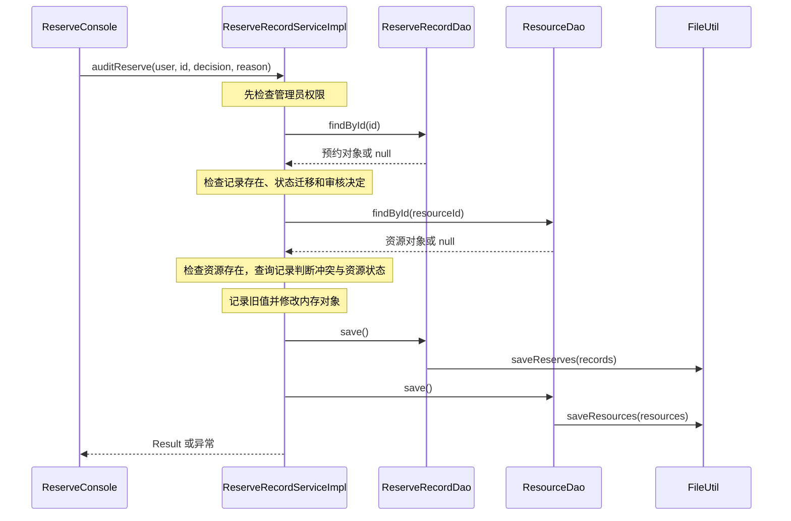

# 综合追问与练习

本章把分散在各文件的知识连成需求、设计、实现和验证的完整过程。题目中的新增输入是教学推演，不是本轮程序运行记录。逐文件细节见 [阅读导航](00-阅读导航与核心知识.md)。

## 从需求到实现

### C01. 如果老师让你现场描述“学生提交预约”用例，应包含哪些部分？

不能只回答“调用 submitReserve”。先确定参与者是学生，目标是为某个校园资源申请一段时间。正常流程为登录、选择申请、输入资源 ID 和起止时间及备注、系统验证、建立 PENDING 记录、保存、返回记录 ID。前置条件包括合法学生身份；具体资源存在、时间有效等条件在操作中检查。

替代流程要与代码相对应：非学生被拒绝；关联资源不存在被拒绝；开始不早于结束被拒绝；结束早于当前时间被拒绝；与 PASS 记录冲突被拒绝；资源非 AVAILABLE 被拒绝；保存失败时撤销本次内存添加并报告错误。正常后置条件是申请已持久化且状态为 PENDING，资源不会因提交而立即变成 OCCUPIED。异常后置条件需要考虑内存恢复与磁盘部分写入的区别，不能写成未经保证的“所有数据绝对不变”。

### C02. 需求、用例、类、函数和测试怎样建立可追溯关系？

可追溯性意味着知道某段实现为何存在，也知道一个需求由什么验证。比如“只能取消本人预约”对应 `ReserveRecordServiceImpl.cancelReserve` 中申请人比较，失败抛 `PermissionDeniedException`，测试应让另一名学生取消同一记录，检查状态和文件没有被正常取消流程改变。

| 业务要求 | 主要实现位置 | 适合验证的输入 |
| --- | --- | --- |
| 学生不能管理资源 | `ResourceServiceImpl.ensureAdmin` 与公开命令 | 学生调用新增、修改、删除 |
| 资源名称不能为空 | `addResource`、`modifyResource` | 空名称与正常名称 |
| 审核不能产生已通过时间冲突 | `requireApprovableResource`、`hasPassConflict` | 重叠与端点相接的两条申请 |
| 只能取消本人记录 | `cancelReserve` | 本人、另一学生、管理员 |
| 最后一条 PASS 取消后才释放 | `findResourceToRelease` | 同资源有一条和两条 PASS |
| 新版能读旧预约数据 | `FileUtil.parseReserveRecord` | 8 字段与 10 字段记录 |

表格不是自动证明。每一行还需写清预期结果、真实输入和运行证据，尤其要避免“代码有这个 if，所以测试就算通过”的循环论证。

### C03. 系统分析中的领域模型为什么不应该直接画成所有 Java 文件的堆积？

领域模型描述业务概念及关系，例如用户提交预约、预约关联资源、预约经历审核。`Scanner`、`DaoFactory`、`BufferedReader` 是实现或技术机制，通常不属于最初的业务领域模型。设计类图可以再加入接口、DAO、工厂和 UI，说明软件职责与依赖。

当前 `ReserveRecord` 用 `resourceId` 和 `applicantUsername` 关联资源与用户。概念层面通常是一名用户对应多条预约、一个资源对应多条预约，但代码和文本存储没有数据库外键约束；允许的删除操作甚至可能留下关联资源已不存在的非 PASS 记录。画关系时要区分“业务期待的关系”和“实现已强制保证的约束”，不要靠一条 UML 关联线掩盖数据完整性问题。

### C04. 三层架构与 MVC 是同一件事吗？当前哪些类承担了控制和展示工作？

UI/Service/DAO 主要按交互、业务规则、数据访问划分职责。MVC 则区分模型、视图和控制器对交互状态与事件的处理，两种划分的关注点不同，不能直接把三个英文名称一一对应。

当前 `ConsoleSession` 和两个 Console 类既读取输入、选择分支，又调用业务服务；`ConsoleOutput` 集中部分输出，其他提示仍在各 Console 类中。因此当前有控制与展示职责，但并未完整拆成独立 View/Controller 层。若后续课程要求 MVC，应根据事件和展示职责再拆分，并通过回归保证输入顺序和提示不变；本轮不能提前把已有三层结构说成已经完成后续任务。

## 从一次操作追踪跨文件协作

### C05. 从管理员选择“通过预约”到成功返回，调用链具体是什么？

`ConsoleSession` 分派给 `ReserveConsole.handleChoice`；后者先检查管理员预约权限，再读取记录 ID 和审核决定。随后经 `ReserveRecordService` 接口调用实际的 `ReserveRecordServiceImpl.auditReserve`。业务层查找记录、校验状态流转和决定值；通过分支再检查关联资源、时间冲突与资源状态。

`updateReserveStatus` 记录旧预约状态、原因、审核时间和资源状态，更新内存，再先保存预约文件、后保存资源文件。两个 File DAO 将各自集合交给 `FileUtil.saveReserves` 和 `saveResources`。正常返回成功 Result 后，UI 展示消息和数据。任一步异常都可能打断后续调用，所以不能在顺序图中把所有分支都画成必然执行。

这张图概括成功通过分支；冲突查询还会读取预约列表，失败补偿见 Service 章节。接口调用与实现对象的执行是同一运行链路的两个观察角度，图中不必额外画一个会独立工作的“接口对象”。

### C06. 为什么两段时间用严格小于判断冲突？能现场推导吗？

把预约视为半开区间 `[start, end)`，结束瞬间可交给下一次预约使用。两段不冲突的情况是 A 在 B 开始前已经结束，或 B 在 A 开始前已经结束，即 `A.end <= B.start` 或 `B.end <= A.start`。对其取反，就得到 `A.start < B.end && B.start < A.end`，与当前 `isBefore` 判断对应。

例如 10:00—11:00 与 11:00—12:00 不重叠，10:00—11:00 与 10:30—11:30 重叠，完全包含和完全相同也重叠。必须先保证每段自身开始早于结束，否则区间模型的前提不成立。当前代码只将 PASS 记录作为冲突来源，PENDING 是申请而不是已确认占用，这属于业务规则，不是数学公式自动决定的。

### C07. 既然检查了时间区间，为什么当前系统仍不能自由预约同一资源的不同未来时段？

因为还存在资源级 `AVAILABLE/OCCUPIED/DISABLED` 状态检查。提交要求资源为 AVAILABLE；一条申请通过后，整个资源被标记为 OCCUPIED，即使新申请的未来时段不重叠，提交仍可能被拒绝。已经存在的 PENDING 记录在审核时又有另一套允许条件，可以在存在其他 PASS 的情况下继续检查并通过非冲突时段。

这暴露了“资源整体状态”和“按时间段可用性”两个概念混合的局限。若需求改为任意时段预约，可将停用等管理状态与时间可用性分开，并明确历史、当前和未来预约的影响；但这是业务模型调整，会改变结果，不能混在接口抽象重构中悄悄完成。课程答辩中能识别这种差别，比把每个现有判断都说成唯一正确方案更有价值。

### C08. 第二个文件保存失败时，现有补偿为什么不能叫数据库事务？

业务层会恢复内存旧值；若预约文件先前已成功保存，还会尝试把预约旧状态重新写回。它处理了一部分“预约已写、资源失败”的不一致，使正常的失败路径更可控。

但文件写入可能已经截断或只写了一部分，进程也可能在两次保存之间退出。补偿写回还可能再次失败，资源文件是否保持旧内容也没有统一保证。数据库事务通常要求在其事务范围内提供明确的原子性等性质，而当前没有统一提交协议或崩溃恢复机制。正确用语是“保存失败补偿”，并说明它覆盖的路径、未覆盖的故障，以及实验到底模拟了哪一种失败。

## 构造、测试与重构

### C09. 怎样设计状态机测试，既完整又不虚构 UI 不存在的操作？

先把 PENDING、PASS、REJECT、CANCEL 四种状态列成当前状态与目标状态的 4×4 矩阵，当前校验允许 PENDING→PASS/REJECT/CANCEL 和 PASS→CANCEL。矩阵说明理论上判断函数应如何对待每一对状态，但 UI 并没有“改回 PENDING”等任意目标状态命令。

公开用例测试应覆盖审核通过、驳回、取消、重复审核、重复取消、终态拒绝和角色/所有权限制；若单独测试私有迁移判断，需明确这种测试层级与生产入口不同。更完整的验证还包括元数据：驳回原因、审核时间、取消是否保留审核信息，以及失败是否恢复关联资源。只数状态名称，不能代替验证转换发生时的完整对象关系。

### C10. 单元测试、集成测试、端到端测试在这个项目中怎样区分？

单元测试应尽量集中验证一个小职责，例如时间冲突判断或结果对象的不变式；如果每个测试都必须加载真实文件，隔离程度就较低。集成测试可以验证 Service、DAO 与 FileUtil 协作后是否正确持久化；端到端测试则向真实 `SystemMain` 输入菜单内容，检查最终提示、文件和重启行为。

当前单例和静态工厂使直接替换 DAO 有一定困难，因此已有回归采用隔离数据目录和新 JVM，避免全局集合污染场景。这样的做法能验证真实链路，但启动成本较高，不代表接口本身已具备完善的依赖注入能力。测试分层应按实际依赖和观察范围判断，不能把所有 Java 断言都叫单元测试。

### C11. 为什么重构回归不能只比较“最后成功了”，还要比较错误顺序和输入消耗？

控制台程序的可观察行为包括提示内容、菜单编号、读取了多少行、异常先后和持久化结果。例如学生选择管理员操作时，当前一些分支先触发权限错误，不读取后续 ID。若重构后先读了 ID 再拒绝，用户原本准备作为下一条菜单选择的输入可能被错误消耗，后续流程就改变了。

同样，`requireResourceForModification` 在读取新字段前检查 ID；审核方法对状态和决定值的校验顺序也决定首先显示什么消息。因此回归要使用相同完整输入序列，比较完整输出和数据，而不是只搜索一个成功字符串。随机 ID 和生成时间可以作保持对应关系的规范化，固定测试值、记录数量和错误消息则不应随意删除。

### C12. 如果想把长函数拆得更短，怎样判断是好重构还是过度设计？

应围绕有独立业务含义的步骤提取函数，例如“验证申请”“查找需要释放的资源”“更新并保存状态”。函数名帮助读者理解意图，调用者不必重新理解每个条件，同时把相关修改与异常恢复放在能一起阅读的位置。

过度拆分的信号包括：大量只有一行却没有业务名称的函数、参数多到必须回头查看调用上下文、错误处理被分散而无法判断恢复顺序、为了统一完全不同的业务强行引入复杂父类。先写清当前行为和测试，再做小步迁移；每一步都能解释减少了哪种认知负担。行数减少不是唯一指标，甚至合理提取后总行数可能略增。

### C13. 当前查找和排序的复杂度是什么？换成 Stream 会自动改变复杂度吗？

列表按 ID 或账号查找最坏通常要看全部 n 个元素，时间为 O(n)。`findAll` 先复制列表，需要 O(n) 时间和额外引用数组空间；随后 `anyMatch` 虽可在找到匹配时短路，但这次复制已经发生。资源查询排序一般需要 O(n log n) 量级的比较工作，具体实现细节不等于业务层需要承诺的固定耗时。

Stream 改变了表达遍历和组合条件的方式，不会把列表扫描变成带索引的查询。若规模增大，可评估按 ID 的 Map 或数据库索引，但还需考虑一致性、重复键和持久化更新。当前项目规模下先把规则写清楚合理；对性能作出更强结论前需要实际测量，不能只凭语法选择。

### C14. 老师要求讲 SOLID，怎样结合项目回答而不是背五个单词？

单一职责可用 UI、Service、DAO 分别承担交互、规则和存储说明；但一个类不等于只能有一个方法。依赖倒置可用 UI 持有 Service 接口、Service 持有 DAO 接口说明，同时承认静态工厂选择仍有耦合。接口隔离可用三个业务接口按用户、资源、预约分开说明，没有让所有调用者依赖一个巨大万能接口。

里氏替换要求替代实现保持调用者依赖的行为约定，例如未找到时如何返回、保存何时发生、是否允许通过返回对象修改状态；仅有相同方法签名不足以证明。开闭原则强调把预期变化放到扩展点，但加入全新存储方式可能仍需修改装配工厂和完善契约。不能把原则理解为“任何需求都只能新增文件、绝不能修改代码”。

### C15. 如果要求你指出现有不足，你会按什么顺序提出改进？

先区分事实和建议。可观察的事实包括 User 字符串表示包含密码、用户数据以文本字段保存，IDE 的 JDK 配置并不完全一致，部分失败路径没有用户/资源的内存回退，资源整体状态限制了非重叠未来申请，共享实体与单例限制了隔离和并发。

改进顺序应结合课程范围和风险：先处理演示与输出中的不必要敏感字段、明确运行环境和数据约定；再补充失败行为测试与一致性规则；只有需求需要时再调整时间可用性模型、依赖装配和存储方式。每个改动都应明确是否改变业务行为，并独立验证。把数据库、Web、线程池和更多设计模式一次性加入，不会自动提高课程项目质量。

## 口头练习方式

先用一分钟回答 K06/K08，解释单例是什么、为何选它以及代价；再用三分钟回答 C05/C08，串起审核调用链和失败边界；最后随机打开任意一个 Java 文件，回答对应章节的前两题并指出源码位置。卡住时应回到具体函数和输入推演，而不是背更多术语。

一份合格回答应能说清“为什么当前这样做”和“什么情况下需要改变”，也应能够承认尚未实现或尚未验证的部分。
